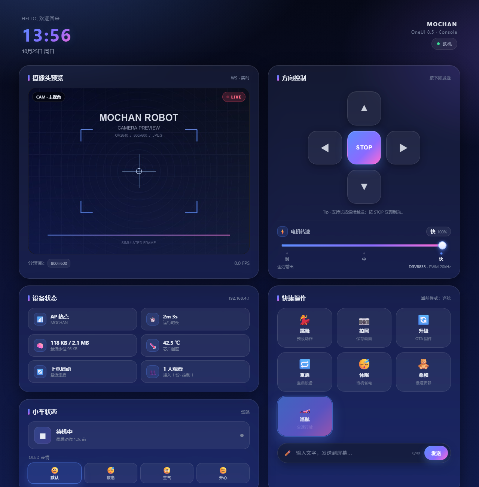
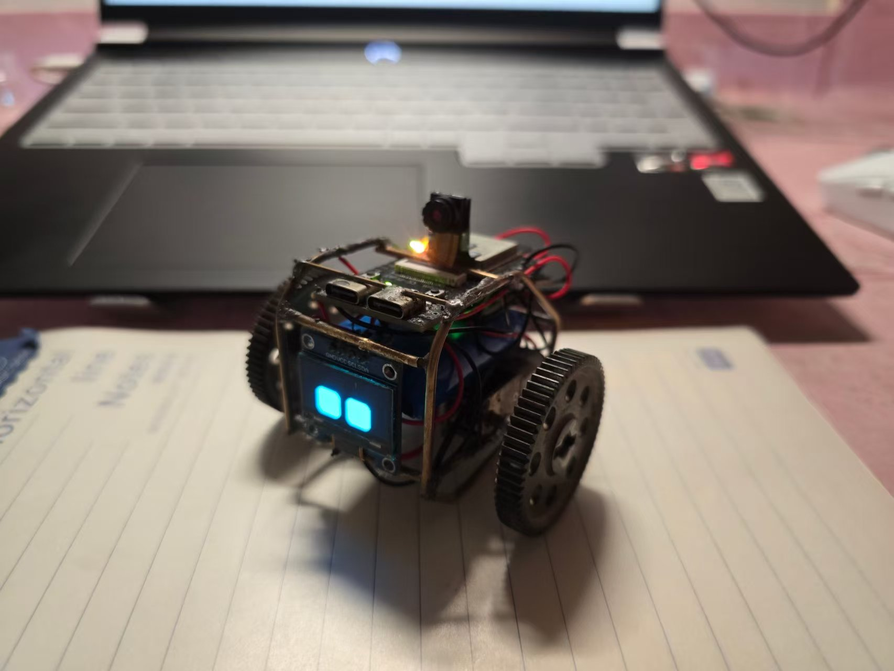
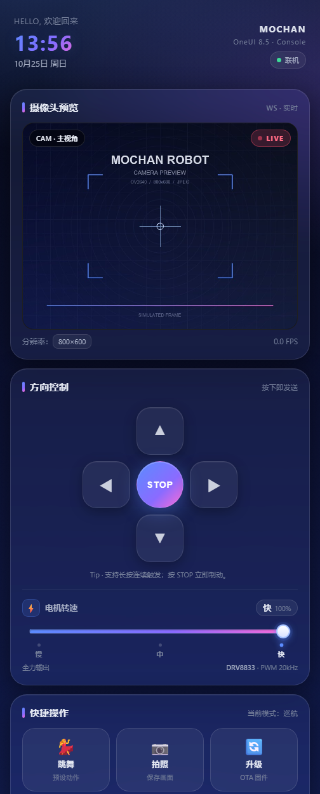
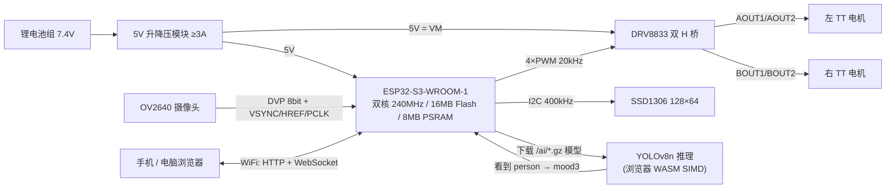
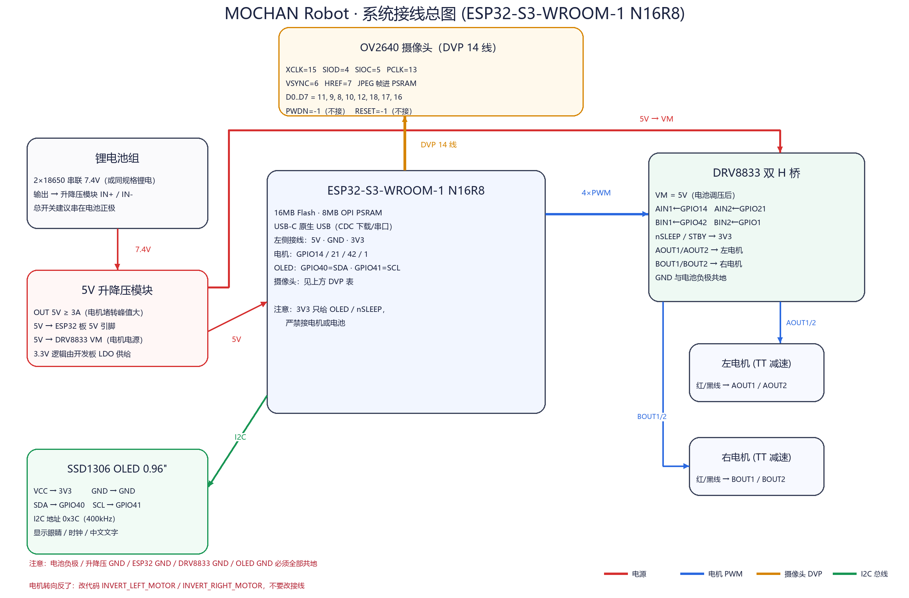
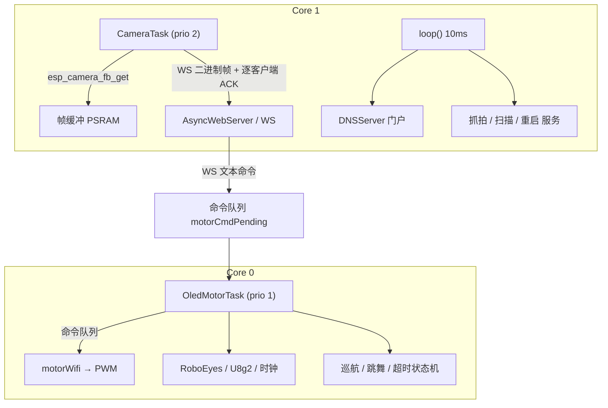
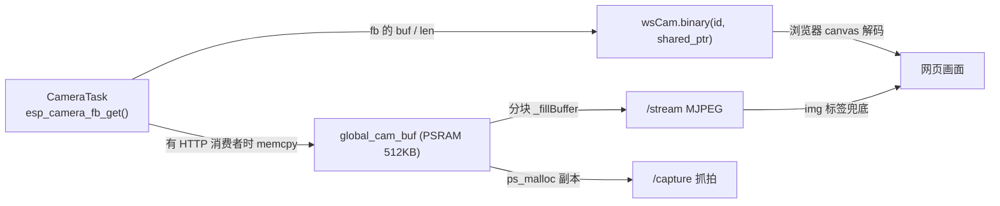
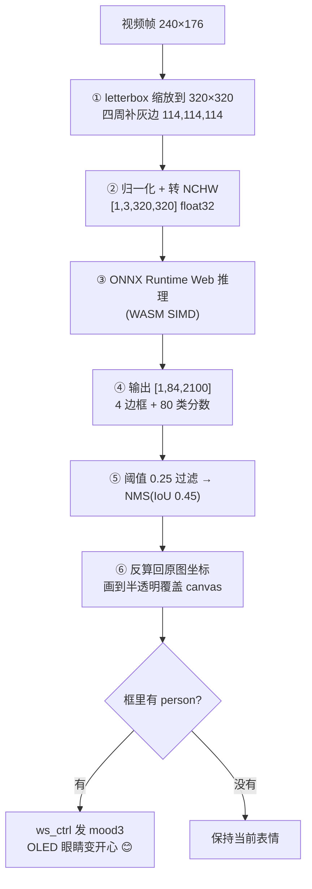

<div align="center">

# MOCHAN Robot

**ESP32-S3 双核 WiFi 视频小车 · 网页实时遥控 + OLED 表情 + 浏览器端 YOLO 目标检测 + OTA 升级**

[](#3-硬件清单bom)
[](#8-arduino-ide-环境配置)
[](#66-视频推流三条链路)
[](#7-ai-画面检测yolov8n)
[](#16-许可证)

[](docs/images/ui-desktop.png)

</div>

> **English** — MOCHAN is a palm-sized two-wheel robot car built on an **ESP32-S3-WROOM-1 N16R8** (16 MB flash / 8 MB octal PSRAM). It streams JPEG video from an **OV2640** camera over a low-latency **WebSocket** channel (with an MJPEG `/stream` fallback), drives two TT gear motors through a **DRV8833** dual H-bridge with 3 speed levels of 20 kHz PWM, renders animated robot eyes / a standby clock / Chinese text on a 128×64 **SSD1306** OLED, and is fully controlled from a phone or PC browser (Samsung OneUI-inspired web console, served gzip-compressed straight from PROGMEM). It also does **on-device-feel AI without the device doing AI**: a **YOLOv8n** model plus ONNX Runtime Web (WASM SIMD) is stored in the robot's 9.9 MB FFat partition and executed **inside the browser**, drawing `person 0.84`-style boxes on the live video and making the robot smile when it sees a human — fully offline. Video grabbing, motor control and OLED rendering run on separate **FreeRTOS tasks pinned to both cores**, with per-client ACK back-pressure, adaptive JPEG quality, NVS-persisted settings, and browser-based **OTA** firmware updates. Everything is in a single Arduino sketch; no cloud, no app, no account.

---

## 目录

- [1. 项目概览](#1-项目概览)
- [2. 功能特性](#2-功能特性)
- [3. 硬件清单（BOM）](#3-硬件清单bom)
- [4. 硬件原理](#4-硬件原理)
- [5. 接线详解](#5-接线详解)
- [6. 代码架构与原理](#6-代码架构与原理)
- [7. AI 画面检测（YOLOv8n）](#7-ai-画面检测yolov8n)
- [8. Arduino IDE 环境配置](#8-arduino-ide-环境配置)
- [9. 快速上手（使用说明）](#9-快速上手使用说明)
- [10. 调参指南](#10-调参指南)
- [11. 常见问题（FAQ）](#11-常见问题faq)
- [12. 已知限制与后续计划](#12-已知限制与后续计划)
- [13. 目录结构](#13-目录结构)
- [14. 参考与致谢](#14-参考与致谢)
- [15. 赞助支持](#15-赞助支持)
- [16. 许可证](#16-许可证)

---

## 1. 项目概览

MOCHAN 是一台「五合一」的掌上机器人：**能看的车（摄像头 + 实时视频）、会动的车（双轮差速）、有表情的机器人（OLED 眼睛）、能上网的设备（AP/STA + 网页控制台 + OTA）、还能自己「看懂画面」的 AI 小车（YOLOv8n 目标检测）**。

它只用 **一块 ESP32-S3 开发板 + 一颗 OV2640 + 一个 DRV8833 + 一块 OLED + 两个 TT 电机**，却把嵌入式开发里最典型的几类问题都踩了一遍：

| 主题 | 本项目中的具体体现 |
| --- | --- |
| 外设驱动 | DVP 并口摄像头、I2C OLED、LEDC PWM、GPIO 死区时序 |
| 实时系统 | FreeRTOS 双核任务、任务通知、互斥锁、非阻塞状态机 |
| 网络协议 | HTTP 静态页 + REST API、WebSocket 文本/二进制双向、MJPEG 推流、DNS 强制门户 |
| 可靠性 | 看门狗式断线回退、OTA 分区与 MD5 校验、上电 GPIO 锁定、故障降级 |
| 前端交互 | 单文件 HTML/CSS/JS 控制台，gzip 内嵌 PROGMEM，自动降级解码 |
| **边缘 AI** | **YOLOv8n + ONNX Runtime Web（WASM SIMD）在浏览器里推理；模型与引擎存在设备 FFat 里，全程离线** |

> 一句话原理：**浏览器 → WebSocket 文本命令 → 命令队列 → 电机任务 → 解码成桥臂电平 → 20 kHz PWM；摄像头任务取帧 → 一帧一 ACK 背压 → WebSocket 二进制推给浏览器 → canvas 解码显示 → （可选）浏览器用 YOLOv8n 画检测框，看到人就发 `mood3` 让机器人笑。**

实物长这样（2×18650 + 5V 升降压 + 亚克力车架 + 顶部摄像头 + 前面板 OLED）：

<div align="center">



</div>

<div align="center">

| 桌面端控制台 | 手机端控制台 |
| --- | --- |
|  |  |

</div>

---

## 2. 功能特性

### 2.1 运动与驾驶

| 功能 | 说明 | 实现位置 |
| --- | --- | --- |
| 方向控制 | 前进 / 后退 / 原地左转 / 原地右转 / 停止（D-Pad，按下即发，支持长按连发） | `motorWifi()` / `onWsCtrlEvent()` |
| 单轮点动 | 仅左前 / 仅左后 / 仅右前 / 仅右后（命令 5~8，用于校准与动画） | `decodeMotorCmdAll()` |
| 三档调速 | 慢 65% / 中 82% / 快 100%，掉电记忆 | `MOTOR_SPEED_DUTY[]` + NVS `motor/spd3` |
| 20 kHz 静音 PWM | 超出人耳可听频段，电机不发啸叫 | `MOTOR_PWM_FREQ` |
| 随机巡航 | 「巡航」全程随机小动作、「柔和」低概率短动作、10 s 无操作自动恢复 | `motorAnimUpdate()` |
| 跳舞 | 25 步预设序列（左右摇摆 3 轮 → 前后 → 小幅 2 轮 → 收尾停车） | `DANCE_SEQ[]` / `danceUpdate()` |
| 失联保护 | 最后一个控制端断开 → 立即停车；手动命令 200 ms 无后续 → 自动停车 | `onWsCtrlEvent()` / `oledMotorTask` |

### 2.2 视频

| 功能 | 说明 |
| --- | --- |
| WebSocket 低延迟主通道 | `/ws_cam` 推送 JPEG 二进制帧，浏览器渲染完回一个 ACK 文本帧，**每个观众在途帧 ≤ 1** |
| MJPEG 兜底通道 | `/stream`（`multipart/x-mixed-replace`），`` 直接可看，直连 `AsyncAbstractResponse` 分块发送 |
| 单帧抓拍 | `/capture` 非阻塞抓拍（continuation + 新鲜度 300 ms + 超时 800 ms） |
| 自适应画质 | 丢帧率 >35% 降 2 档、<8% 升 1 档，JPEG 质量在 q14~q28 之间动态调节（三条视频通道同源） |
| 按需更新全局帧缓存 | 5 s 内没有 HTTP 消费者（`/stream`、`/capture`）就停更共享缓冲，省 PSRAM 拷贝 |
| 参数可调 | SVGA 800×600、q18、3 帧缓冲、上限 30 fps（全部为宏） |

### 2.3 显示与交互

| 功能 | 说明 |
| --- | --- |
| 机器人眼睛 | `FluxGarage_RoboEyes` 矢量眼睛：默认 / 疲惫 / 生气 / 开心 4 种表情 + 自动眨眼 + 空闲动作 |
| 开机动画 | 白闪 → 扫描线 → 故障风 MOCHAN → 进度条（每 20% 让电机点动）→ 表情轮播 → 四方向自检 → 显示 WiFi/IP 3 秒 |
| 休眠时钟 | 数字雨 + 虚线扫描线 + 大号 HH:MM:SS + 秒级进度条（时间来自浏览器同步） |
| 中文文字 | 网页输入 → OLED 显示 5 秒；纯 ASCII 走 Adafruit 快速通道，含中文自动切 U8g2 文泉驿 GB2312 点阵并自动折行 |

### 2.4 网络与系统

| 功能 | 说明 |
| --- | --- |
| AP 模式（默认） | 热点 `MOCHAN` / `12345678`，DNS 强制门户（访问任意域名都跳到本机），默认 `192.168.4.1` |
| STA 模式 | 网页里扫描 + 输入家里 WiFi，保存进 NVS 后重启连接；发射功率 21 dBm，关闭省电降延迟 |
| 断线自愈 | STA 断线超过 60 s 自动清配置并重启回 AP，避免「变砖」 |
| 状态遥测 | `/status` 每 2 s 轮询：RSSI、IP、内存、PSRAM、芯片温度、复位原因、在线数、模式、表情、转速… |
| OTA | `/ota` 网页选 `.bin` 上传，支持 `X-Firmware-MD5` 完整性校验，成功后自动重启 |
| 配置持久化 | WiFi 模式/账号密码、电机档位分别存 NVS，清 WiFi 不动电机设置 |
| 全中文串口日志 | 5 个 Phase 的启动日志 + 电机/摄像头/网络运行日志，带限流避免刷屏 |

### 2.5 AI 画面检测（YOLOv8n）

| 功能 | 说明 |
| --- | --- |
| 浏览器端推理 | YOLOv8n ONNX 模型 + ONNX Runtime Web（WASM SIMD）在**手机/电脑浏览器**里跑，机器人 CPU 零负担 |
| 离线可用 | 引擎（47 KB JS + 2.8 MB WASM）与模型（2.6 MB）都存在设备 **FFat 9.9 MB 分区**的 `/ai/` 下，首次从设备下载后进浏览器缓存，**不需要互联网** |
| 实时画框 | 视频上叠一层透明 canvas，画出 `person 0.84` 这样的「类别 + 置信度」标签（显示全部 COCO 80 类，阈值 0.25） |
| 看到人就开心 | 检测到 `person` → 通过 `/ws_ctrl` 发 `mood3` → OLED 眼睛变开心；人离开 → 发 `mood0` 恢复（带状态去抖，不会疯狂刷命令） |
| AI 跟随 | 点「🚶 跟随」后，浏览器实时上报人的水平偏移（`ai:tx:-1.00~1.00`），机器人小步转向把人保持在画面中央（只转向不前进，详见 [7.9](#79-ai-跟随机器人转头看着你)） |
| 不抢推流 | 机器人照常 30 fps 推流，AI 按自己的节奏（约 5 fps）从最新帧取快照；推理没算完就跳过该帧，**丢帧不排队** |
| 失败降级 | 模型/WASM 加载失败只关掉 AI 开关并提示，视频、方向控制、OTA 全部照常 |

> 完整原理、数据流、部署方式和排错见 [7. AI 画面检测（YOLOv8n）](#7-ai-画面检测yolov8n)。

---

## 3. 硬件清单（BOM）

### 3.1 必选清单

| # | 元件 | 建议型号 / 规格 | 数量 | 作用 | 备注 |
| --- | --- | --- | --- | --- | --- |
| 1 | 主控板 | **ESP32-S3-WROOM-1 N16R8** 核心板（16 MB Flash + 8 MB **Octal/OPI** PSRAM，板载 USB-C） | 1 | 大脑：双核 240 MHz + WiFi + DVP 接口 | PSRAM 必须是 **8 线（OPI）**，否则摄像头帧缓冲吃紧 |
| 2 | 摄像头模组 | **OV2640**（200 万像素，DVP 并口，自带 JPEG 压缩） | 1 | 视频采集 | 通常买 24 pin FPC 排线的成品模组；PWDN/RESET 悬空即可 |
| 3 | 电机驱动 | **DRV8833** 双 H 桥模块（常见红色/蓝色小板） | 1 | 驱动左右两个电机 | 支持 2.7~10.8 V、单路 1.2 A 连续；可替代 TB6612 |
| 4 | 减速电机 | **TT 电机**（双轴或单轴，1:48 减速比常见），3~6 V | 2 | 左右驱动轮 | 本项目**不使用编码器**（开环控制） |
| 5 | 车轮 | 65 mm 或 80 mm 橡胶轮（配 TT 电机轴） | 2 | 行走 | |
| 6 | 万向轮 | 小号牛眼轮 / 塑料万向轮 | 1 | 前（或后）支撑 | 没有万向轮就做「差速两轮 + 一点支撑」的简易平衡 |
| 7 | 显示屏 | **SSD1306 OLED 0.96" 128×64 I2C** | 1 | 眼睛 / 时钟 / 文字 | I2C 地址通常 `0x3C`（个别 `0x3D`） |
| 8 | 电池 | 2×18650 串联（7.4 V）或等规格锂电组 | 1 | 能量来源 | 必须带保护板或外接保护电路 |
| 9 | 电源模块 | **5 V 升降压模块（输出 ≥ 3 A）** | 1 | 统一 5 V 母线 | 电机堵转峰值电流远大于空载，电流余量要足 |
| 10 | 车架 | 亚克力双层/三层小车底板（2WD 智能车套件） | 1 | 结构 | 本项目用的就是常见的两轮智能车底板 |
| 11 | 杜邦线/端子 | 母对母、公对母若干；电池用 XH2.54 或焊接 | — | 连接 | 电机线建议用更粗的线 |
| 12 | 开关 | 船型开关 / 自锁按钮（串在电池正极） | 1 | 总电源 | 强烈建议加，避免每次插拔电池 |

### 3.2 可选 / 调试用

| 元件 | 用途 |
| --- | --- |
| 万用表 | 上电前测 5 V 母线、确认共地 |
| USB-C 数据线 | 下载固件 + 串口日志（必须是数据线，不能是充电线） |
| 面包板 / 洞洞板 | 固定电源模块与分线，避免杜邦线松动 |
| 0.1 µF + 100 µF 电容 | 并在电机电源两端，抑制换向尖峰（电机干扰大时必备） |
| 散热片 / 扎带 | DRV8833 长时间大电流会发热 |

### 3.3 供电与电流预算（重要）

| 负载 | 典型电流 | 峰值 |
| --- | --- | --- |
| ESP32-S3（WiFi 开启 + 摄像头推流） | 150~250 mA @ 5 V | ~500 mA（射频突发） |
| OV2640 | 60~120 mA | — |
| SSD1306 OLED | 10~25 mA | — |
| 单个 TT 电机（空载/行走） | 120~250 mA | 堵转 **1 A 以上** |
| **合计（行走）** | **≈ 0.7~1.0 A** | **堵转可达 2~2.5 A** |

> 结论：**5 V 母线至少 3 A**。用 1 A 的小降压模块会出现「一加速就重启 / 屏幕闪 / WiFi 掉线」——这不是程序 bug，是电压跌落触发了欠压复位。

### 3.4 AI 功能需要额外硬件吗？

**不需要。** 目标检测跑在浏览器里，机器人这边只多占一点 Flash——具体是 **9.9 MB 的 FFat 分区**（`16M Flash (3MB APP/9.9MB FATFS)` 方案自带），用来存 3 个 AI 资源文件：

```text
/ai/ort.wasm.min.js.gz      ≈ 47 KB    onnxruntime-web 的 JS 胶水层
/ai/ort-wasm-simd.wasm.gz   ≈ 2.8 MB   推理计算核心（WebAssembly + SIMD）
/ai/yolov8n.onnx.gz         ≈ 2.6 MB   YOLOv8n 模型
合计 ≈ 5.5 MB / 9.9 MB，还剩约 4.4 MB 可以换更大的模型
```

代价在**浏览器**一侧：手机需要支持 WebAssembly + SIMD（Chrome/Edge 91+、Safari 16.4+、Firefox 89+），首次打开 AI 会下载约 5.5 MB 资源（局域网内 1~3 s），之后走缓存秒开。详见 [7. AI 画面检测（YOLOv8n）](#7-ai-画面检测yolov8n)。

---

## 4. 硬件原理

### 4.1 系统框图



### 4.2 电源系统：为什么统一 5 V

1. **ESP32-S3 的 5V 引脚内部接 LDO/DC-DC**（多数核心板是 ME6211 或类似 3.3 V LDO），输入 5 V 后由板载 LDO 给芯片和 3.3 V 逻辑供电。所以开发板 5V 脚既能「吃」5 V，也等于把 5 V 母线引到了板子上。
2. **DRV8833 的 VM（电机电源）范围 2.7~10.8 V**。TT 电机额定 3~6 V，5 V 正好；如果用 7.4 V 直供电机，转速更高但电流、发热、齿轮磨损都急剧上升。
3. 因此本项目采用「**电池 → 5 V 升降压 → 一路给板子、一路给 DRV8833 VM**」的单母线结构，只需要一个电源模块，接线简单，也不会出现「电机一堵转把 MCU 电压拖垮」的双电源地环路问题（前提是共地良好）。

**关键约束：**

- 电池正负极**绝不能**接反（模块基本没有反接保护，反接即烧）。
- 3.3 V 引脚**只能**给 OLED、DRV8833 的 `nSLEEP/STBY` 这类逻辑引脚用，禁止接电机或电池。
- 所有 GND 必须**共地**：电池负极、升降压 GND、开发板 GND、DRV8833 GND、OLED GND。
- 电机是感性负载，换向瞬间会产生负压尖峰。电机线尽量短、绞在一起；有条件在 DRV8833 的 VM/GND 之间并 100 µF 电解 + 0.1 µF 瓷片。

### 4.3 DRV8833 双 H 桥调速原理

#### （1）H 桥是什么

一个电机有两条线，要让它正反转，就得能把这两条线的电压极性对调。H 桥用 4 个 MOSFET 组成「H」形：

```
        VM (5V)
     ┌────┬────┐
    Q1   │   Q3
     │    │    │
    AOUT1 │  AOUT2
     │    │    │
    Q2   │   Q4
     └────┴────┘
        GND
```

- 导通 **Q1 + Q4** → 电流 AOUT1 → 电机 → AOUT2，正转
- 导通 **Q3 + Q2** → 电流反向，反转
- 全关 → 电机两端悬空（**滑行 / coast**）
- 下桥 Q2 + Q4 同时导通 → 电机两端被短接到 GND（**刹车 / brake**）

**绝对不能**同时导通同一侧的 Q1 + Q2（上下管直通），那等于把 5 V 直接短路到 GND，会瞬间烧管。DRV8833 内部有互锁逻辑防止直通，但**代码里我们仍然先全部关断 2 ms 再上 PWM**（下面会讲为什么）。

#### （2）DRV8833 的真值表（本项目用到的部分）

| AIN1（= LF） | AIN2（= LB） | 左轮状态 | 说明 |
| --- | --- | --- | --- |
| `PWM` | `0` | **正转**，占空比 = PWM | 本项目前进时使用 |
| `0` | `PWM` | **反转** | 本项目后退时使用 |
| `0` | `0` | 滑行（coast） | 停止 / PWM 的低电平区间 |
| `1` | `1` | 刹车（brake） | 本项目**不使用** |

> 代码里每个轮子始终只有「一路输出 PWM、另一路输出 0」，所以 PWM 的低电平段电机处于滑行状态（fast decay）。这带来两个后果：
> ① 效率不是最高（低占空比时滑行多、平均力矩下降）；
> ② 电机噪声小、发热低。
> 这也是为什么**最低档不设到 0~20%**，而是从 **65%（duty 166）** 起步——经验上 duty 低于 60% 左右时 TT 电机常常「嗡嗡响但原地不动」（静摩擦 + 减速箱死区）。

#### （3）PWM 调速怎么做

ESP32-S3 的 **LEDC** 外设产生硬件 PWM：给定频率和分辨率，`ledcWrite()` 改变占空比，硬件自动翻转引脚，**不占用 CPU**。

```
20 kHz / 8 bit  →  一个周期 50 µs，被分成 256 份，每份 ≈ 195 ns
duty = 166  →  高电平占 166/256 ≈ 65%，平均电压 ≈ 5V × 0.65 = 3.25 V
```

**为什么选 20 kHz？**

- 人耳听觉上限约 20 kHz，**20 kHz 的 PWM 已经听不到**（低于 8 kHz 时电机会发出刺耳的「嗞——」）。
- DRV8833 支持到 **250 kHz**，20 kHz 处于中间地带：开关损耗可接受，MOSFET 也来得及开关。
- 分辨率：LEDC 时钟 80 MHz，80 MHz / 20 kHz = 4000 个计数步，8 bit（256 步）绰绰有余。

**为什么电机用 LEDC 通道 4~7？**

摄像头驱动的 **XCLK 固定占用 LEDC channel 0 / timer 0**（`esp_camera_init()` 内部会申请）。如果电机也用通道 0~1，会和摄像头抢同一个定时器，表现为「摄像头初始化后电机 PWM 频率变化 / 抖动 / 失效」。所以代码把电机挂在 4、5、6、7：

```cpp
static const uint8_t MOTOR_LEDC_CH[4] = {4, 5, 6, 7};   // 避开摄像头的 channel 0
```

#### （4）代码里的安全时序（这是本项目最讲究的一段）

```cpp
static inline void motorPwmApply(int lf, int lb, int rf, int rb) {
  uint8_t mask = (lf ? 0x1 : 0) | (lb ? 0x2 : 0) | (rf ? 0x4 : 0) | (rb ? 0x8 : 0);
  uint8_t duty = motorDuty();

  motorActiveMask = 0;      // ① 切换期间不让「只改速度」的函数刷新旧方向
  motorPwmWriteMask(0, 0);  // ② 四路先全部关断
  delay(2);                 // ③ 2 ms 死区：等 H 桥彻底关断

  for (uint8_t i = 0; i < 4; i++) {
    if (mask & (1u << i)) {
      delay(1);             // ④ 逐路上电，每路间隔 1 ms
      motorPwmWriteIdx(i, duty);
    }
  }
  motorActiveMask = mask;   // ⑤ 记录当前方向，切档时原地改占空比
}
```

逐条解释：

1. **死区 2 ms**：从「正转」直接切「反转」时，如果上桥还没完全关断就打开另一侧，会出现瞬间短路电流（shoot-through）。先全关 2 ms 是最便宜的保险。
2. **逐路软启动 1 ms**：两个电机同时从 0 起转，浪涌电流叠加，可能把 5 V 母线拉塌导致 ESP32 复位。错开 1 ms 后峰值电流大约减半。
3. **`motorActiveMask`**：记录「现在哪几路在输出」，网页拖动转速滑块时只要 `motorPwmWriteMask(mask, 新duty)`，**不重新走死区与软启动**，所以调速是连续无感的。

### 4.4 OV2640 + DVP 摄像头原理

OV2640 是 **200 万像素 CMOS 图像传感器**，最大的优点：**内部自带 JPEG 压缩引擎**，可以直接输出 `.jpg` 数据流，省掉 ESP32 做软件编码的巨大开销（软件 JPEG 在 800×600 下只能跑到个位数 fps）。

它通过 **DVP（Digital Video Port）并口**与 ESP32-S3 的 **LCD_CAM 外设**相连：

| 信号 | 方向 | 作用 |
| --- | --- | --- |
| `XCLK` | ESP32 → 摄像头 | 主时钟，本项目 **20 MHz** |
| `PCLK` | 摄像头 → ESP32 | 像素时钟，每个上升沿采一个字节 |
| `VSYNC` | 摄像头 → ESP32 | 场同步：一帧开始/结束 |
| `HREF` | 摄像头 → ESP32 | 行有效：一行像素开始/结束 |
| `D0~D7` | 摄像头 → ESP32 | 8 bit 并口数据（一个 PCLK 送 1 字节） |
| `SIOD/SIOC` | 双向 | SCCB 总线（本质是 I2C），用于读写传感器寄存器 |

**一帧是怎么来的：**

```
VSYNC 上升 → 一帧开始
  每一行: HREF 高 → 按 PCLK 逐字节读入 D0..D7 → 写入帧缓冲
VSYNC 下降 → 一帧结束 → 驱动把整块缓冲标记为「可读」
```

**ESP32-S3 的关键优势**：它的 LCD_CAM 外设可以**把 DVP 数据直接 DMA 进 PSRAM**，CPU 完全不参与搬运。800×600 的 JPEG（约 30~90 KB）因此可以稳定 20~30 fps。

**本项目参数（`1.ino` 第 856 行附近）：**

```cpp
#define CAM_STREAM_FRAMESIZE   FRAMESIZE_SVGA   // 800x600
#define CAM_STREAM_JPEG_Q      18               // 质量基准（数值越小越清晰、帧越大）
#define CAM_STREAM_FB_COUNT    3                // 3 个帧缓冲
#define CAM_STREAM_MAX_FPS     30               // 推流上限
config.grab_mode    = CAMERA_GRAB_LATEST;       // 永远取最新帧（丢旧帧，不排队）
config.fb_location  = CAMERA_FB_IN_PSRAM;       // 帧缓冲放 PSRAM
```

- **`CAMERA_GRAB_LATEST`**：画面延迟的根源是「队列里堆着旧帧」。这个模式保证你拿到的永远是最新一帧，代价是可能丢掉中间帧——但这正是实时遥控想要的。
- **3 个帧缓冲**：一个正在被 DMA 写入、一个等待读取、一个备用，避免读帧时丢帧。
- **SCCB 初始化**：`esp_camera_init()` 通过 SIOD/SIOC 把一大堆寄存器写进 OV2640（分辨率、JPEG 质量、白平衡、曝光…），之后调整画质只需 `sensor->set_quality(q)`。

### 4.5 SSD1306 OLED（I2C）原理

SSD1306 是 **128×64 单色** 驱动 IC：每个像素 1 bit，整屏显存（GDDRAM）= 128 × 64 / 8 = **1024 字节**。

- 显存按 **页（page）** 组织：8 页 × 128 列，每字节竖着表示 8 个像素。
- 主控通过 **I2C（400 kHz）** 把 1 KB 显存整块刷进去，一帧 ≈ 1 KB / 400 kHz ≈ 25 ms（含协议开销约 30~40 ms），所以全屏刷新最高约 25~30 fps。
- 本项目 I2C 使用 **GPIO40=SDA / GPIO41=SCL**，地址 **0x3C**。

**三个库共用同一块屏**（这是很多人会踩的坑）：

| 库 | 用途 | 驱动方式 |
| --- | --- | --- |
| `Adafruit_SSD1306` | 开机动画、休眠时钟、ASCII 文字 | 自己的缓冲区 + `display()` |
| `U8g2` | 中文（文泉驿 GB2312 点阵） | 自己的缓冲区 + `sendBuffer()` |
| `FluxGarage_RoboEyes` | 眼睛表情动画 | 内部调用 `Adafruit_SSD1306` 的绘图函数 |

三者共用 `Wire`（I2C0），但**同一时刻只有一个在画**（都在 `oledMotorTask` 里串行执行），所以不会打架。代码里还有一个细节：

```cpp
u8g2.begin();
Wire.begin(OLED_SDA, OLED_SCL);   // u8g2.begin() 内部会无参调用 Wire.begin()，可能把引脚复位
Wire.setClock(400000);            // 所以必须重新指定 SDA/SCL 并重设速率
```

### 4.6 WiFi 与网页通信原理

#### （1）AP 与 STA 两种模式

| 模式 | 谁连谁 | 地址 | 使用场景 |
| --- | --- | --- | --- |
| **AP（热点）** | 手机/电脑连机器人 | 机器人 `192.168.4.1` | 刚拿到手、户外、没有路由器 |
| **STA（客户端）** | 机器人连家里路由器 | 路由器分配的 `192.168.x.x` | 家里/办公室，延迟更低、距离更远 |

- AP 模式下还跑了一个 **DNS 服务器**（`DNSServer`，53 端口），把所有域名都解析到 `192.168.4.1`，所以手机连上热点后随便打开一个网址都会跳到控制台（Captive Portal / 强制门户）。
- STA 模式连接时把 **发射功率拉到 21 dBm** 并 **关闭 WiFi 省电**（`WIFI_PS_NONE`）：前者增强穿墙能力，后者避免「省电休眠」导致的视频卡顿（省电模式下射频会周期性打盹，延迟可达几百毫秒）。
- STA 断开超过 60 s → 清配置 → 重启回 AP（防止写错 WiFi 密码后彻底失联）。

#### （2）为什么不用「HTTP 轮询」而是 WebSocket

| 方案 | 上行（按键） | 下行（视频） | 延迟 |
| --- | --- | --- | --- |
| HTTP 轮询 | 每次按键一个 GET，有 TCP 握手/队头开销 | 需要 MJPEG 长连接 | 100~300 ms，抖动大 |
| **WebSocket** | 复用一条 TCP 长连接，一帧几十字节 | 服务端主动 push 二进制帧 | 10~60 ms（局域网） |

本项目用**两条独立的 WebSocket**：

- `/ws_ctrl`：文本通道，传输 `f`/`b`/`l`/`r`/`s`、`spd0~2`、`mode_*`、`mood0~3`、`dance`、`text=...`。
- `/ws_cam`：二进制通道，只传 JPEG 帧；浏览器上行任何一帧都当作上一帧的 **ACK**。

分开的好处：视频拥塞时不会阻塞控制指令；控制通道断开时视频还能继续。

#### （3）背压（Back-pressure）—— 低延迟的核心

TCP 本身有发送缓冲。如果服务端不管客户端能不能消费就拼命发，帧会堆在发送队列里，**延迟越积越大**（看起来卡、操作有滞后感）。本项目的做法：

```
服务端: 给客户端 A 推第 N 帧 → 标记 A "awaitingAck"
浏览器: 收到帧 → 解码 → 渲染到 canvas → 回一个文本帧 "1"
服务端: 收到 A 的上行帧 → awaitingAck = false → 第 N+1 帧可以发了
```

于是「每个观众最多只有 1 帧在途」：网络快就流畅，网络慢就**掉帧**而不是**延迟**。为避免客户端根本不回 ACK 导致画面冻结，还有一层兜底：**200 ms 没等到 ACK 也强行发下一帧**（`CAM_WS_ACK_TIMEOUT_MS`）。

#### （4）自适应画质

摄像头任务是唯一改 JPEG 质量的地方。它**每 2 s 评估一次**，用「发送成功 / 丢帧」计数（计数每 5 s 在打印统计时清零）算出丢帧率：

| 丢帧率 | 动作 | 效果 |
| --- | --- | --- |
| > 35% | 质量档 +2（更糊、帧更小） | 网络跟不上 → 减小带宽需求 |
| < 8% | 质量档 -1（更清晰） | 网络富余 → 逐步追回画质 |
| 其他 | 不动 | 稳定在中间 |

质量档被夹在 **q14（最清晰）~ q28（最省流量）** 之间。注意 `set_quality()` 改的是**传感器**的 JPEG 压缩参数，所以 WS、`/stream`、`/capture` 三条通道的画质会**一起变化**；它下一帧即生效，**不重启采集**，也只有摄像头任务会在丢帧统计触发时去调它。

---

## 5. 接线详解

### 5.1 接线总图

<div align="center">



</div>

> 该图由 `tools/make_wiring_diagram.py` 用 Pillow 生成（`python tools/make_wiring_diagram.py`），改完引脚可直接重跑。

### 5.2 完整引脚分配表

#### 电机（DRV8833 输入侧）

| 功能 | ESP32 引脚 | DRV8833 引脚 | 代码宏 | 备注 |
| --- | --- | --- | --- | --- |
| 左轮正转桥臂 | **GPIO14** | `AIN1` | `LF` | LEDC 通道 4 |
| 左轮反转桥臂 | **GPIO21** | `AIN2` | `LB` | LEDC 通道 5 |
| 右轮正转桥臂 | **GPIO42** | `BIN1` | `RF` | LEDC 通道 6 |
| 右轮反转桥臂 | **GPIO1** | `BIN2` | `RB` | LEDC 通道 7 |
| 使能 | **3V3** | `nSLEEP`（或 `STBY`） | — | 必须拉高，否则芯片休眠、电机不转 |
| 电机电源 | **5V 母线** | `VM` | — | ≥3 A |
| 地 | **GND** | `GND` | — | 与电池负极相连 |
| 电流检测 | — | `AISEN`/`BISEN`（模块上常已接地） | — | 模块没引出就不用管 |

#### OLED（I2C）

| OLED 引脚 | ESP32 引脚 | 说明 |
| --- | --- | --- |
| `VCC` | **3V3** | 不要接 5V（SSD1306 模块多数只耐 3.3 V） |
| `GND` | **GND** | |
| `SDA` | **GPIO40** | |
| `SCL` | **GPIO41** | |

#### 摄像头（OV2640，DVP 14 线）

| OV2640 信号 | ESP32 引脚 | 代码宏 | 说明 |
| --- | --- | --- | --- |
| `XCLK` | **GPIO15** | `XCLK_GPIO_NUM` | 20 MHz 主时钟（占用 LEDC timer0） |
| `PCLK` | **GPIO13** | `PCLK_GPIO_NUM` | 像素时钟 |
| `VSYNC` | **GPIO6** | `VSYNC_GPIO_NUM` | 场同步 |
| `HREF` | **GPIO7** | `HREF_GPIO_NUM` | 行同步 |
| `SIOD`（SDA） | **GPIO4** | `SIOD_GPIO_NUM` | SCCB 数据 |
| `SIOC`（SCL） | **GPIO5** | `SIOC_GPIO_NUM` | SCCB 时钟 |
| `D0` | **GPIO11** | `Y2_GPIO_NUM` | |
| `D1` | **GPIO9** | `Y3_GPIO_NUM` | |
| `D2` | **GPIO8** | `Y4_GPIO_NUM` | |
| `D3` | **GPIO10** | `Y5_GPIO_NUM` | |
| `D4` | **GPIO12** | `Y6_GPIO_NUM` | |
| `D5` | **GPIO18** | `Y7_GPIO_NUM` | |
| `D6` | **GPIO17** | `Y8_GPIO_NUM` | |
| `D7` | **GPIO16** | `Y9_GPIO_NUM` | |
| `PWDN` | — | `-1` | 不接（或接 GND） |
| `RESET` | — | `-1` | 不接 |
| `3V3` | **3V3** | — | 摄像头由板载 3.3 V 供电 |
| `GND` | **GND** | — | |

> ⚠ 摄像头排线（FPC）**金手指朝向**很关键：插反了不会烧，但会一直 `esp_camera_init()` 失败（错误码 `0x105`/`0x101`）。插好后轻拉一下确认卡住。

#### 电源

| 从 | 到 | 线材建议 |
| --- | --- | --- |
| 电池 `+`（经开关） | 升降压模块 `IN+` | 22AWG 以上 |
| 电池 `−` | 升降压模块 `IN−` | 22AWG |
| 升降压 `OUT+ 5V` | 开发板 `5V` 引脚 | 22AWG |
| 升降压 `OUT+ 5V` | DRV8833 `VM` | 22AWG（电机电流大） |
| 升降压 `OUT− GND` | 开发板 `GND` + DRV8833 `GND` + OLED `GND` | 22AWG，**必须共地** |

### 5.3 接线步骤（推荐顺序）

1. **断电**，电池不接。
2. 先接 **电源骨架**：电池 → 开关 → 升降压 IN；升降压 OUT 的 5V/GND 先留空。
3. 接 **地线总线**：把升降压 GND、开发板 GND、DRV8833 GND、OLED GND 全部接到一个公共点（可以拿一小块洞洞板做 GND 排）。
4. 接 **OLED**（VCC→3V3，GND，SDA→40，SCL→41）。
5. 接 **DRV8833 逻辑侧**：AIN1←14、AIN2←21、BIN1←42、BIN2←1、nSLEEP→3V3。
6. 接 **DRV8833 功率侧**：VM←5V，GND←公共地；AOUT1/AOUT2 接左电机，BOUT1/BOUT2 接右电机。
7. 接 **摄像头排线** 到开发板 CAM 座。
8. **上电前检查**（非常重要）：
   - [ ] 电池极性正确
   - [ ] 5V 与 GND 没有短路（万用表通断档测）
   - [ ] 所有 GND 连通（蜂鸣档）
   - [ ] nSLEEP 已接 3V3
   - [ ] **把车架空**（轮子离地），第一次上电不要放地上
9. 接电池上电 → 看 OLED 是否出现开机动画、串口是否有 5 个 Phase 的日志。
10. 如果轮子转向反了：**不要改接线**，改代码里的极性开关（下一节）。

### 5.4 电机方向反了怎么办（不用重接线）

`1.ino` 第 92~100 行：

```cpp
#define INVERT_LEFT_MOTOR   false   // 左轮整体反转
#define INVERT_RIGHT_MOTOR  true    // 右轮整体反转（本项目右轮接线相反，故为 true）
#define SWAP_LEFT_RIGHT_MOTOR false  // 左右轮对调（电机插反了两个口时用）
```

原理：`applyMotorPolarity()` 只交换「哪一路该导通」的语义，不改变逻辑命令，所以改完重新烧录即可，接线一根都不用动。

- 「前进时车往右偏」→ 通常是某一侧电机接反，把对应 `INVERT_*` 取反。
- 「前进变后退、后退变前进」→ 两个都对调（或 `SWAP_LEFT_RIGHT_MOTOR = true`）。

### 5.5 常见接线错误与后果

| 错误 | 现象 | 后果 |
| --- | --- | --- |
| 未共地 | 屏幕花屏、电机抖动、摄像头初始化失败 | 逻辑电平漂浮，随机故障（最难排查） |
| 3.3 V 接了电机 | 开发板瞬间重启或 LDO 烧毁 | 板子报废 |
| nSLEEP 悬空 | 电机完全不转，但代码日志正常 | DRV8833 处于休眠 |
| 电机接反 | 前进变后退 | 用 `INVERT_*` 宏修正 |
| 电池接反 | 模块冒烟 | 烧毁 |
| 摄像头排线插反/没插到底 | `Camera init failed: 0x105` | 视频不可用，其它功能正常 |
| OLED 地址不是 0x3C | 屏幕全黑 | 改 `display.begin(..., 0x3D)` |
| 电机线太长/没绞合 | WiFi 掉线、视频卡顿 | 电磁干扰，缩短线并加电容 |
| 5 V 电源电流不足 | 一加速就重启 | 换 ≥3 A 模块 |

---

## 6. 代码架构与原理

### 6.1 文件结构

```text
1/
├── 1.ino                  # 全部固件逻辑（≈2700 行，7 个区块，带中文详解注释）
├── web_content.h          # 控制台网页（HTML/CSS/JS）→ PROGMEM 字符串
├── web_content_gz.h       # 上面网页的 gzip 预压缩版本（由 tools 生成，勿手改）
├── camera-placeholder.jpg # 早期界面的占位图（当前代码未引用，可删除）
├── tools/
│   ├── embed_web.py       # 重新生成 web_content_gz.h（Python 标准库）
│   ├── embed_web.cjs      # 同上，Node.js 版本
│   └── make_wiring_diagram.py  # 生成本文档的接线总图
├── docs/
│   └── images/            # README 用图：实物、桌面/手机 UI、接线图
└── archive/               # 早期模块化版本（config.h + hw/net/utils），保留作参考
```

`1.ino` 内部按注释分为 7 块（区块是**逻辑分组**，代码顺序有交错，所以行号区间会重叠，例如 `[2]` 的电机代码插在 `[1]` 的全局对象之前）：

| 区块 | 内容 | 大致行号 |
| --- | --- | --- |
| `[1]` | 头文件、引脚宏、全局对象、共享状态 | 21~330 |
| `[2]` | DRV8833 三档 PWM、命令映射、极性、NVS 读写 | 116~682 |
| `[3]` | OLED 休眠时钟、开机动画、文字显示 | 330~845 |
| `[4]` | 摄像头初始化、MJPEG `/stream`、`/capture` | 847~1314 |
| `[5]` | 动作动画、跳舞序列 | 1316~1501 |
| `[6]` | WiFi、时间同步、全部 Web 路由、两个 WebSocket | 1503~2248 |
| `[7]` | FreeRTOS 双核任务、`setup()`、`loop()` | 2250~2686 |

### 6.2 双核任务划分

ESP32-S3 有两个 Xtensa LX7 核心。项目把「必须实时」的两件事拆开，避免互相拖累：

| 任务 | 核心 | 优先级 | 栈 | 周期 | 职责 |
| --- | --- | --- | --- | --- | --- |
| `OledMotorTask` | **Core 0** | 1 | 8 KB | 20 ms 或收到通知时立即醒 | 执行电机命令（含 delay 时序）、画 OLED、推进巡航/跳舞/超时状态机 |
| `CameraTask` | **Core 1** | 2 | 8 KB | 1/(30 fps) ≈ 33 ms 取帧 | 取帧 → 更新共享帧缓冲 → WS 推流 → 统计与自适应画质 |
| `loop()` | **Core 1**（Arduino 主循环） | 1 | — | 10 ms | DNS 门户、清理 WS 客户端、抓拍队列、WiFi 扫描、延迟重启、断线看门狗 |
| `async_tcp` | 任意 | 高 | 库内 | 事件驱动 | HTTP/WS 回调（**绝不能在里面 delay 或等锁**） |



**为什么电机命令要「入队」而不是直接在 Web 回调里执行？**

`motorPwmApply()` 里有 `delay(2)` + 最多 4 次 `delay(1)`，共 **6 ms**。如果直接在 `async_tcp` 任务里跑，这 6 ms 会冻结**所有**网络回调（视频帧、HTTP 响应全卡）。所以 Web 回调只做「写全局变量 + `xTaskNotifyGive()`」：

```cpp
static inline void motorEnqueue(byte c) {
  motorCmdPending = c;
  motorCmdHasTimed = false;
  motorCmdValid = true;
  if (OledMotorTaskHandle) xTaskNotifyGive(OledMotorTaskHandle);  // 立刻唤醒电机任务
}
```

电机任务在循环末尾 `ulTaskNotifyTake(pdTRUE, pdMS_TO_TICKS(20))`：有通知立刻返回，没通知最多等 20 ms。**指令延迟 ≈ 微秒级，网络任务零阻塞。**

### 6.3 启动流程（Phase 1~5）

```
上电 / 复位
 ├─ Serial.begin(115200)
 ├─ earlyMotorPinLockdown()   ← 第一件事！4 个电机脚 pinMode(OUTPUT)+LOW
 ├─ motorPwmInit()            ← LEDC 通道 4~7 @20kHz/8bit，驱动强度拉满
 ├─ loadMotorSpeed()          ← 从 NVS 恢复档位
 │
 ├─ [Phase 1/5] 芯片信息 / 互斥锁 / PSRAM 帧缓存(512KB) / 随机种子
 ├─ [Phase 2/5] 读 NVS WiFi 配置 → 尝试 STA(最多 20s) → 失败则 AP 热点
 │              → setupServer() 注册路由 + WebSocket
 ├─ [Phase 3/5] Wire(40,41)@400kHz → SSD1306 → U8g2 → RoboEyes → bootAnimation()
 ├─ [Phase 4/5] initCamera()（失败不阻塞其它功能）
 ├─ [Phase 5/5] 电机 PWM 重申 0%
 │
 └─ xTaskCreatePinnedToCore(OledMotorTask → Core 0, CameraTask → Core 1)
    loop(): DNS / 清理客户端 / 服务挂起请求 / 断线看门狗
```

**为什么第一件事是锁电机引脚？**
GPIO 上电默认是高阻输入。DRV8833 的输入悬空时可能被干扰、漏电流拉到高电平，表现就是 **「一上电轮子自己转」**。所以 `earlyMotorPinLockdown()` 必须在 WiFi 连接（可能阻塞十几秒）、开机动画、摄像头初始化**之前**执行：

```cpp
static inline void earlyMotorPinLockdown() {
  const int motorPins[4] = {LF, LB, RF, RB};
  for (int i = 0; i < 4; i++) {
    pinMode(motorPins[i], OUTPUT);
    digitalWrite(motorPins[i], LOW);
  }
}
```

### 6.4 电机控制链路（命令 → 电平）

```
网页 D-Pad 按下
  └─ WebSocket "f"
       └─ onWsCtrlEvent(): motorAnimStop() + manualActive=true + motorEnqueue(1)
            └─ motorCmdPending = 1, xTaskNotifyGive()
                 └─ OledMotorTask 醒来 → motorWifi(1)
                      ├─ 12 ms 防抖（长按连发不冲击 H 桥）
                      ├─ 取 motor_mutex（10 ms 超时，拿不到就丢弃）
                      ├─ decodeMotorCmdAll(1) → lf=1, rf=1（左前 + 右前）
                      ├─ applyMotorPolarity()  → 按 INVERT_* 宏交换
                      ├─ motorPwmApply()       → 死区 2ms + 逐路 1ms 软启动 + 写 duty
                      └─ 日志限流 200 ms 后打印一行
```

命令编号对照表（`decodeMotorCmdAll()`）：

| 编号 | 名称 | LF | LB | RF | RB | 效果 |
| --- | --- | --- | --- | --- | --- | --- |
| 0 | STOP | 0 | 0 | 0 | 0 | 四路全关，滑行停车 |
| 1 | FWD | 1 | 0 | 1 | 0 | 两轮正转前进 |
| 2 | BACK | 0 | 1 | 0 | 1 | 两轮反转后退 |
| 3 | LEFT | 0 | 1 | 1 | 0 | 左轮反转 + 右轮正转 = 原地左转 |
| 4 | RIGHT | 1 | 0 | 0 | 1 | 左轮正转 + 右轮反转 = 原地右转 |
| 5 | LBACK | 0 | 1 | 0 | 0 | 仅左轮后退 |
| 6 | RBACK | 0 | 0 | 0 | 1 | 仅右轮后退 |
| 7 | LFWD | 1 | 0 | 0 | 0 | 仅左轮前进 |
| 8 | RFWD | 0 | 0 | 1 | 0 | 仅右轮前进 |

> 「原地转向」= 两轮反向转，靠差速实现，不需要舵机。这也是两轮差速小车的标准做法。

### 6.5 三档 PWM 与档位记忆

```cpp
static const uint8_t MOTOR_SPEED_DUTY[3] = {166, 209, 255}; // 65% / 82% / 100%
static const uint8_t MOTOR_SPEED_PCT [3] = {65, 82, 100};   // 仅用于显示
volatile uint8_t motorSpeedLevel = 2;                       // 默认「快」
```

- **为什么从 65% 起步**：duty 低于约 150（59%）时 TT 电机常常「嗡嗡响但不转」，因为静摩擦 + 减速箱死区；而且低占空比下 coast 时间长、力矩更弱。
- **档位记忆**：档位写入 NVS 命名空间 `motor`，键 `spd3`（注释说明用 `spd3` 是为了和旧版 4 档数据区分，避免读到脏值）。加载时只接受 `0~2`，脏值自动回落到 0，防止数组越界。
- **行驶中切档**：`motorSpeedSet()` 若发现 `motorActiveMask != 0`，只调用 `motorPwmWriteMask(mask, 新duty)` 原地刷新占空比，**不重走死区**，所以调速顺滑不断顿。

### 6.6 视频推流：三条链路



| 链路 | 端点 | 私有缓冲 | 适用 |
| --- | --- | --- | --- |
| **WS 主通道** | `/ws_cam`（二进制） | 无（直接共享帧缓冲，只拷贝一次给所有客户端） | 主页默认，低延迟 |
| **MJPEG 兜底** | `/stream`（`multipart/x-mixed-replace`） | 每个客户端 512 KB | 老浏览器 / WS 与 canvas 都失败时自动降级 |
| **单帧抓拍** | `/capture`（`image/jpeg`） | 每请求临时 `ps_malloc` | 「拍照」按钮 |

**关键实现要点：**

1. **共享缓冲只拷贝一次**：`std::make_shared<std::vector<uint8_t>>(fb->buf, fb->buf + fb->len)` 一次构造，再 `wsCam.binary(id, frame)` 发给 N 个客户端，避免「每个客户端一份拷贝」把 PSRAM 打爆。
2. **空闲时不更新全局缓存**：只有 5 s 内有人访问过 `/stream` 或 `/capture`（`httpCamLastReqMs`）才把帧 `memcpy` 到 `global_cam_buf`，否则纯 WS 场景每帧白拷几十 KB。
3. **抓拍不阻塞**：`/capture` 用 `request->pause()` 把请求挂起放进 `captureQueue`（上限 8 个），由 `loop()` 里的 `serviceCaptureQueue()` 在帧新鲜（<300 ms）时回复，超过 800 ms 回 503。**handler 里绝不 delay/等锁。**
4. **大帧保护**：`fb->len > CAM_BUF_MAX_SIZE`（512 KB）时丢弃并限流告警，防止 PSRAM 越界。
5. **PSRAM 回退**：若 `heap_caps_malloc(512KB, MALLOC_CAP_SPIRAM)` 失败，会退到内部 DRAM 的一半容量（256 KB），并相应限制拷贝；再失败则 HTTP 视频/抓拍不可用，但 WS 推流仍可用（它不需要全局缓存）。

### 6.7 WebSocket 协议

#### `/ws_ctrl`（文本）

| 消息 | 含义 | 备注 |
| --- | --- | --- |
| `f` / `b` / `l` / `r` / `s` | 前 / 后 / 左 / 右 / 停 | 立即入队并标记为「手动」 |
| `f,12` | 带序号的旧格式 | **序号被忽略**（WebSocket 本身基于 TCP 有序，无需去重） |
| `spd0` / `spd1` / `spd2` | 慢 / 中 / 快 | 等价于 `speed=0/1/2` |
| `speed=N` | 设置档位 | 越界自动夹紧 |
| `mode_off` | 休眠（屏幕变时钟，停止巡航） | `/mode_soft`、`/mode_normal` 同理 |
| `mood0`~`mood3` | 默认 / 疲惫 / 生气 / 开心 | |
| `dance` | 跳一段舞（25 步序列） | 结束自动恢复巡航 |
| `text=你好+世界` | OLED 显示文字 5 秒 | `+` 会被还原成空格 |
| `ai:person` | 浏览器检测到 person（开心彩蛋） | 每 1 s 续杯一次 |
| `follow_on` / `follow_off` | AI 跟随模式 开 / 关 | 开启时暂停自动巡航 |
| `ai:tx:0.45` | 跟随：目标水平偏移 −1（最左）~ +1（最右） | 量化到 0.1、变化或 ≥200 ms 才发 |

#### `/ws_cam`（二进制 + ACK）

| 方向 | 内容 |
| --- | --- |
| 服务端 → 浏览器 | 二进制帧 = 一整个 JPEG 文件（无额外头） |
| 浏览器 → 服务端 | 任意文本帧 = 上一帧的 ACK（内容不解析） |

服务端每个客户端维护 `{id, awaitingAck, lastSendMs}`；发帧前筛选「没在等 ACK 或等待超时」的客户端。

### 6.8 HTTP API

| 方法 | 路径 | 参数 | 返回 | 说明 |
| --- | --- | --- | --- | --- |
| GET | `/` | — | HTML（gzip 优先） | 控制台主页 |
| GET | `/ping` | — | `pong` | 连通性探测（前端每 5 s） |
| GET | `/f` `/b` `/l` `/r` `/s` | — | 200 | 方向控制，非阻塞入队 |
| GET | `/speed` | `level=0..2` | `{"ok":true}` | 带校验的调速 |
| GET | `/spd0` `/spd1` `/spd2` | — | 200 | 调速 HTTP 兜底 |
| GET | `/display_text` | `text=...` | `OK` | OLED 显示文字 |
| GET | `/mood` | `m=0..3` | `OK` | 换表情 |
| GET | `/mode_off` `/mode_soft` `/mode_normal` | — | 200 | 运行模式 |
| GET | `/dance` | — | 200 | 跳舞 |
| GET | `/status` | — | JSON | 遥测（见下） |
| GET | `/stream` | — | MJPEG 流 | 视频兜底通道 |
| GET | `/capture` | — | JPEG | 抓拍 |
| GET | `/sync_time` | `timestamp=<unix>` | `OK` | 浏览器同步时间（每分钟一次） |
| GET | `/wifi_scan` | — | `[{"ssid","rssi"}]` | **异步**扫描，最长 10 s |
| GET | `/wifi_save` | `ssid=&pwd=` | `OK` | 存 NVS → 500 ms 后重启进 STA |
| GET | `/wifi_ap` | — | `OK` | 清配置 → 重启回 AP |
| GET | `/restart` | — | `Restarting...` | 响应发出后复位 |
| GET | `/ota` | — | HTML | OTA 升级页 |
| POST | `/update` | 表单文件 + 头 `X-Firmware-MD5` | `OK` / `Update failed` | 固件上传 |

`/status` 返回字段：

| 字段 | 说明 |
| --- | --- |
| `ssid` `rssi` `ip` `wifimode` | 网络信息（AP 模式 `rssi=0`） |
| `uptime` | 开机毫秒数 |
| `heap` `psram` `minheap` | 剩余内部 RAM / PSRAM / 历史最小堆 |
| `temp` | 芯片内部温度（`temperatureRead()`） |
| `rst` | 复位原因枚举（`esp_reset_reason()`：1=上电，3=软复位，4/5/6/7=看门狗/异常等） |
| `wscam` `wsctrl` `apstas` | 视频连接数 / 控制连接数 / AP 下挂设备数 |
| `mode` | `off` / `soft` / `normal` |
| `sleep` `mood` | 是否休眠 / 当前表情 |
| `speed` `speedpct` `speedduty` | 档位 0~2 / 百分比 / 占空比 |
| `motor.cmd` `motor.name` `motor.active` `motor.ago` | 最后一条电机命令及其距今毫秒 |

### 6.9 OLED 显示系统

三种画面互斥切换，由 `oledMotorTask` 每轮决定画谁：

```cpp
if (textDisplayActive) { ...显示文字（5 秒后自动消失）... }
else if (sleepMode)    { drawSleepScreen(); }   // 休眠：数字雨 + 时钟
else                   { roboEyes.update(); }   // 正常：眼睛动画
```

- **眼睛**：`roboEyes.begin(128, 64, 100)`（100 = 帧率参数），四种 mood，自动眨眼 `setAutoblinker(ON, 3, 2)`、空闲动作 `setIdleMode(ON, 2, 2)`。开机动画期间会临时关掉这两项避免干扰。
- **休眠时钟**：数字雨（每列随机落 `0/1`）+ 虚线扫描线（水平/垂直随机切换，碰边 2 次有 2/3 概率换向）+ 大号 `HH:MM:SS`（冒号每 0.5 s 闪烁）+ 秒级进度条 + 双层边框。时间是「浏览器同步的 Unix 时间戳 + 本地 `millis()` 走时」，所以**不需要 NTP**、也不需要联网校时。
- **文字**：`textDisplayBuf[129]` 存 UTF-8。检测到非 ASCII 就切 U8g2 的 `u8g2_font_wqy12_t_gb2312`，用 `getUTF8Width()` 按像素宽度自动折行（最多 4 行，垂直居中）；纯 ASCII 走 Adafruit 的 6×8 字体，短文本（≤10 字符）自动放大到 2 号字。

### 6.10 随机巡航与跳舞

**随机巡航**（`motorAnim` 结构 + `motorAnimUpdate()`，每 20 ms 推进）：

| 模式 | 触发概率（每 40 ms 判定一次） | 运动时长 | 停止时长 | 步数 |
| --- | --- | --- | --- | --- |
| 柔和 `soft` | 1/120 | 6~17 ms | 40~89 ms | 1 |
| 正常 `normal` | 1/100 | 5~49 ms | 10~99 ms | 0~19 |

「动一下 → 停一下」构成一个 phase，全部走完自动停。手动操作会立刻暂停动画；松手 10 s 后（`AUTO_RESUME_DELAY`）才恢复巡航。

**跳舞**（`DANCE_SEQ[]`，存在 PROGMEM，用 `memcpy_P` 读 ROM 不占 RAM）：

```cpp
static const DanceStep DANCE_SEQ[] PROGMEM = {
  {3,150},{0,200},{4,150},{0,200},   // 左右摇摆 第 1 轮
  {3,150},{0,200},{4,150},{0,200},   // 第 2 轮
  {3,150},{0,200},{4,150},{0,200},   // 第 3 轮
  {1,200},{0,250},{2,200},{0,250},   // 前进、停、后退、停
  {3,100},{0,150},{4,100},{0,150},   // 小幅左右
  {3,100},{0,150},{4,100},{0,150},   // 再一轮
  {0,1},                             // 收尾停车
};
```

### 6.11 并发与内存安全

| 机制 | 保护对象 | 说明 |
| --- | --- | --- |
| `motor_mutex`（二值信号量） | 电机引脚/极性/`motorActiveMask` | Web 任务与电机任务都可能写引脚 |
| `cam_mutex` | `global_cam_buf` / `global_cam_len` / `global_cam_seq` | 摄像头任务写、HTTP 任务读 |
| `camClientsMutex`（`std::mutex`） | 每个观众的在途状态链表 | **持锁时绝不调用 `wsCam.*`**，否则和 async_tcp 的 `_ws_clients_lock` 形成 AB-BA 死锁 |
| `captureQueueMutex` | 挂起抓拍请求队列 | 锁内只做整表 swap，`memcpy` 与 `send()` 都在锁外 |
| `volatile` 标志 | `manualActive`、`motorCmdValid`、`sleepMode`… | 跨任务可见性（单写单读的简单场景足够） |

**内存布局：**

| 区域 | 用途 | 大小 |
| --- | --- | --- |
| Flash PROGMEM | 两个网页（原版 47 KB + gzip 备份 20 KB）、跳舞序列、`F()` 字符串常量 | ≈ 90 KB |
| PSRAM | 摄像头帧缓冲（3 帧）| 由驱动分配 |
| PSRAM | `global_cam_buf` | 512 KB（失败回退 256 KB DRAM，再失败禁用 HTTP 视频） |
| PSRAM | 每个 MJPEG 客户端缓冲 | 512 KB |
| 内部 DRAM | 任务栈 8 KB×2、驱动缓冲、WiFi 栈 | — |

> 结论：**没有 PSRAM 这块板子跑不动 SVGA 推流**，这就是必须选 N16R8 的原因。

### 6.12 NVS 持久化

| 命名空间 | 键 | 类型 | 默认 | 说明 |
| --- | --- | --- | --- | --- |
| `mochan` | `wifi_mode` | int | 0 (AP) | 0=AP，1=STA |
| `mochan` | `sta_ssid` | string | `""` | 路由器 SSID |
| `mochan` | `sta_password` | string | `""` | 路由器密码 |
| `motor` | `spd3` | uint8 | 2 | 转速档位 0~2（不随 WiFi 清除） |

「切回热点」只 `preferences.clear()` 命名空间 `mochan`，所以**清 WiFi 不会丢转速档位**。

### 6.13 OTA 升级原理

1. 前端 `/ota` 页面选择 `.bin`，读取文件计算 MD5，放进请求头 `X-Firmware-MD5`。
2. 上传到 `POST /update`，服务端在**第一块数据**到达时 `Update.begin(UPDATE_SIZE_UNKNOWN)`，随后逐块 `Update.write()`。
3. `Update.setMD5()` 必须在 `begin()` 之后调用（`begin` 会重置状态）。
4. 每块写入长度不符（Flash 出错）立刻 `Update.abort()`，避免「半截固件被当成成功」。
5. `Update.end(true)` 成功后 `scheduleReboot(1000)` —— **不是立刻 restart**，而是记一个宽限期，由 `loop()` 在网络任务把响应冲出去之后再复位（否则浏览器只会看到「请求失败」）。

分区要求：必须有 **app0 / app1 / otadata** 三个分区（本项目的 `16M Flash (3MB APP/9.9MB FATFS)` 方案满足），否则 `Update.begin()` 直接报错。

### 6.14 网页资源：PROGMEM + gzip

- 页面源码在 `web_content.h` 里写成**普通字符串字面量拼接**（不用 `R"delim()"` 原始字符串，因为 `.ino` 的预处理器可能错误配对引号，导致 JS 的 `function` 关键字泄漏到 C++ 作用域）。
- `web_content_gz.h` 是同一份 HTML 的 **gzip 预压缩字节数组**：主页 44,924 字符（47,498 B）→ gzip 后 **14,439 B**；OTA 页 16,327 字符（17,020 B）→ gzip 后 **6,007 B**（压缩比约 3.2×）。
- 运行时按 `Accept-Encoding` 决定发哪一份，**直接从 PROGMEM 发出，不拷到堆**：

```cpp
static void sendProgmemHtml(AsyncWebServerRequest *request,
                            const uint8_t *plain, size_t plainLen,
                            const uint8_t *gzip, size_t gzipLen) { ... }
```

修改网页的流程（**必须做**，否则改完不生效）：

```bash
# 1) 编辑 web_content.h 里的 PAGE_HTML_MAIN / PAGE_HTML_OTA
# 2) 重新生成 gzip 头（Python 标准库即可）
python tools/embed_web.py
# 或 Node 版
node tools/embed_web.cjs
# 3) 重新编译上传固件
```

> 补充：**AI 的 3 个文件不走 PROGMEM**，而是存在 FFat 分区里、按 HTTP 请求返回（`/ai/*.gz`），所以换模型**不用重新编译固件**，详见 [7.3](#73-三个-ai-文件引擎--计算核心--模型)。

---

## 7. AI 画面检测（YOLOv8n）

> **一句话原理**：机器人只负责「给画面」和「存文件」，**推理跑在你手机/电脑的浏览器里**——用 ONNX Runtime Web（WebAssembly）加载 YOLOv8n，把每一帧缩成 320×320 喂进去，拿回几百个候选框，NMS 去重后画在视频上；只要其中有一个 `person`，就通过控制通道让机器人把眼睛变成开心。

<div align="center">


</div>

### 7.1 为什么 AI 跑在浏览器，而不是 ESP32 里

这是本项目最重要的架构决策，算一笔账就清楚了：

| 方案 | 内存 | 单帧推理耗时 | 对视频的影响 | 其他代价 |
| --- | --- | --- | --- | --- |
| **ESP32-S3 本地跑**（TFLite Micro / ESP-DL） | YOLOv8n FP32 权重约 12 MB，**8 MB PSRAM 放不下**；INT8 量化约 3.2 MB 勉强能放，但会和摄像头 3 帧缓冲、512 KB 共享帧缓冲抢内存 | 320×320 输入约 **0.3~2 s/帧**（S3 无 NPU，只有通用向量指令） | 严重抢占 CPU 与 PSRAM 带宽，推流会掉到个位数 fps | 模型裁剪/量化门槛高，换模型要重新烧固件 |
| **浏览器跑**（ONNX Runtime Web） | 模型、WASM 都在手机/电脑内存里，**机器人零负担** | PC 约 **0.1 s/帧**，手机 **0.2~0.4 s/帧** | 机器人照常按 30 fps 推流 | 依赖浏览器性能；手机发热；首次要下载 ~5.5 MB 资源 |

结论：**把「算力密集」的推理卸载给浏览器，机器人只当摄像头 + 文件服务器**。这样既不用换硬件，也不占 3 MB 的 APP 分区，换模型只要替换 FFat 里的一个文件。

### 7.2 YOLO 模型到底是什么

#### （1）YOLO 是什么

YOLO（You Only Look Once）是**单阶段（one-stage）目标检测器**：只看一次图像就同时回归出「框在哪」和「框里是什么」，不需要像两阶段方法那样先出候选区域再分类，所以特别快。名字里的 `n`（nano）是最小的一档：参数量约 316 万，精度换速度。

它可以理解成一个**压缩了「识别经验」的压缩包**：在训练服务器上看过几百万张标注图（COCO 数据集），学会了「人长什么样、猫长什么样、杯子长什么样」。**推理时它不会学习，只做一次前向计算。**

#### （2）网络结构（三层）

```text
输入 320×320×3
   │
   ├─ Backbone（CSPDarknet + C2f 模块）      ← 提特征：边缘→纹理→语义
   │
   ├─ Neck（PAN-FPN，自顶向下 + 自底向上融合） ← 把大目标的语义和小目标的细节混起来
   │
   └─ Head × 3（stride 8 / 16 / 32）          ← 在三个尺度上各出一批预测
              ↓
        输出张量 [1, 84, N]
```

- **stride 8 的头**看 40×40 网格（小目标），**stride 16** 看 20×20，**stride 32** 看 10×10（大目标）。
- 合计候选框数 `N = 40² + 20² + 10² = 2100`（换成 640×640 输入就是 8400）。
- 输出张量 `[1, 84, N]` 里的 **84 = 4 + 80**：4 个边框参数 `(cx, cy, w, h)` + **80 个 COCO 类别的分数**。
- `cx, cy` 是相对网格的偏移，`w, h` 相对整图；都是 0~1 的归一化值，**需要用输入尺寸换算成像素**。
- YOLOv8 是 **anchor-free**：不再预设一堆先验框，直接预测框的位置，这也是它比 v5 更简单的原因。

#### （3）COCO 80 类里我们关心的

COCO 的 80 个类别里 **`person` 是第 0 类**，其余是 bicycle、car、dog、cat、cup、phone… 本项目**显示全部 80 类**（阈值 0.25），但只有 `person` 会触发机器人的表情反馈。

#### （4）模型文件

设备 FFat 里的 `yolov8n.onnx.gz` 是 **gzip 压缩后的 ONNX 文件**（2.6 MB）。ONNX 是一种开放的「模型中间格式」：把网络结构和权重序列化成 protobuf，任何支持 ONNX 的推理引擎都能读。浏览器端的引擎就是 **ONNX Runtime Web**，它用 WebAssembly 实现了 ONNX 的全部算子。

> 如果你的模型是用 `yolov8n.pt` 导出的，导出命令大致是 `yolo export model=yolov8n.pt format=onnx opset=12 imgsz=320`（`imgsz` 必须是 32 的倍数，且与前端 letterbox 的尺寸一致）。

### 7.3 三个 AI 文件：引擎 + 计算核心 + 模型

设备 FFat 的 `/ai/` 目录下有 3 个文件，缺一不可：

| 文件 | 作用 | 大小 | 说明 |
| --- | --- | --- | --- |
| `/ai/ort.wasm.min.js.gz` | **JS 胶水层**：ORT Web 的 API、张量管理、加载 WASM | ≈ 47 KB | 压缩后很小，前端下载最快 |
| `/ai/ort-wasm-simd.wasm.gz` | **计算核心**：所有算子（Conv、MatMul、Resize…）的 C++ 实现编译成 WebAssembly，`simd` 版使用 128 位向量指令 | ≈ 2.8 MB | 比非 SIMD 版快 **30%~50%**，是耗时大头 |
| `/ai/yolov8n.onnx.gz` | **模型**：网络结构 + 权重 | ≈ 2.6 MB | 真正「认识人」的知识在这里 |

**三个为什么：**

- **为什么全部 gzip**：FFat 只有 9.9 MB，3 个文件解压后约 5.5 MB 原始体积更大；压缩后既省 Flash 又省 WiFi 传输时间（AP 模式下实测 2~5 MB/s，首次加载 5.5 MB 约 1~3 s）。
- **浏览器怎么解压**：两种常见做法——
  1. 固件把文件以 `Content-Encoding: gzip` 返回，**浏览器自动透明解压**（但注意 `.wasm` 必须同时带 `Content-Type: application/wasm`，否则 ORT 会报 `magic word` 错误）；
  2. 固件当普通二进制返回，前端用 `new DecompressionStream('gzip')`（或 pako）手动解压成 `ArrayBuffer` 再交给 ORT。
- **为什么不需要互联网**：模型、WASM、JS 全部从**机器人自己的局域网服务**取，浏览器第一次取走后进 HTTP 缓存 / Cache Storage，之后打开 AI 是**秒开**。野外没网也能用。

### 7.4 部署：把模型写进设备的 FFat（9.9 MB 仓库）

这就是为什么分区方案要选 `16M Flash (3MB APP/9.9MB FATFS)`——**9.9 MB 的 FAT 分区正好当 AI 的文件仓库**（分区表见 [Arduino IDE 环境配置](#84-tools-菜单逐项配置) 的「说明 ②」）。

空间账：

```text
FFat 总容量    9.9 MB  (0x9E0000 = 10,354,688 B)
AI 资源占用    约 5.5 MB
剩余可用       约 4.4 MB   ← 以后换更大模型（如 yolov8s）也放得下
```

**方式 A：网页上传（推荐，用户不用装工具）**

```text
① 手机/电脑连上机器人 → 打开控制台
② 进入 AI/文件管理页 → 选择 3 个 .gz 文件 → 逐个上传
③ 固件按文件名写入 /ai/，写完列出目录与文件大小供你核对
④ 打开「AI 检测」开关 → 前端从 /ai/ 拉取 → 解压 → 初始化 ORT → 开始逐帧检测
```

**方式 B：一次性烧写 FFat 镜像（适合批量/离线）**

用 `mklittlefs`（LittleFS）或 `mkfatfs`（FAT）把 `ai/` 目录打成镜像，再用 esptool 烧到 FFat 分区起始地址：

```bash
# 按分区表: ffat 起始 0x610000, 大小 0x9E0000 (仅示意, 工具名按你用的版本)
mkfatfs -c ai -s 0x9E0000 ffat.bin
esptool.py --chip esp32s3 -p COM4 write_flash 0x610000 ffat.bin
```

**注意**

- **OTA 升级固件不会动 FFat**，模型可以一直留着；
- 但 `Erase All Flash Before Sketch Upload = Enabled` 或整片擦除会清空 FFat，需要重新上传；
- 上传后如果浏览器报 404，先在浏览器直接访问 `http://<设备IP>/ai/yolov8n.onnx.gz` 验证文件是否真的在。

### 7.5 每一帧画面经历什么（完整流水线）



#### ① 取帧与降采样

AI **不直接吃 640×480 的原始帧**，而是先把画面缩到约 **240×176**（前端用离屏 canvas / `ImageBitmap` 一步缩放完成）。原因很简单：缩图本身很便宜，但**输入越小推理越快**，而 320 的输入本来也只需要这么大。

#### ② letterbox：为什么四周要补灰边

YOLO 要求固定正方形输入（320×320），但画面是 240×176 的长方形。如果直接拉伸，人和物体都会被压扁，检测精度明显下降。**letterbox** 的规则是「等比缩放 + 居中补边」：

```text
scale = min(320/240, 320/176) = 1.333
缩放后 = 320 × 235          （240×1.333=320, 176×1.333≈235）
上下各补 (320-235)/2 ≈ 42 像素的灰边（RGB 114,114,114 —— YOLO 训练时的标准填充色）
```

> 记住这两个数 `scale` 和 `padX/padY`，因为**后处理必须用它们把框换算回原图坐标**，否则框会整体偏移——这是自己实现检测时最常见的 bug。

#### ③ 归一化与数据布局

- 像素从 `uint8`（0~255）转成 `float32` 并 **除以 255**（YOLO 训练时就是这样归一化的）；
- 布局从 `HWC`（高、宽、通道交错）转成 **`NCHW`**：`[1, 3, 320, 320]`，R 通道一整块、G 一整块、B 一整块。ORT 对 NCHW 的卷积更快。
- 一个 `float32` 的 320×320×3 张量 = **1.2 MB**，所以这块内存要**只分配一次、每帧复用**，千万别每帧 new。

#### ④ 推理

```js
const session = await ort.InferenceSession.create(onnxBytes, {
  executionProviders: ['wasm'],       // 浏览器里只有 wasm（可选 webgpu）
  graphOptimizationLevel: 'all',
});
const out = await session.run({ images: inputTensor });   // out 里一般是 [1,84,2100]
```

#### ⑤ 后处理：阈值 + NMS

模型一口气吐出 **2100 个候选框**，绝大多数是「背景」或「瞎猜」，要筛两轮：

1. **按分数过滤**：对每个候选取 80 类里分数最高的那一类，`score < 0.25` 直接丢弃；
2. **NMS（非极大值抑制）**：同一个物体常被预测出 3~10 个重叠框。按分数从高到低排，**保留最高分框，把与它 IoU（交并比）> 0.45 的同类别框全部删掉**，剩下的就是「每个物体一个框」。

```text
IoU = 两个框的交集面积 / 两个框的并集面积       (0~1)
IoU > 0.45 → 认为它们是同一个物体，只留分高的
```

3. **坐标反算**：把框从 320 空间映射回原视频坐标

```text
x_原图 = (x_320 - padX) / scale
y_原图 = (y_320 - padY) / scale
```

#### ⑥ 画框：为什么用「覆盖层」

视频本身是 `<canvas>` 或 ``（MJPEG 兜底）。框和文字绝对**不能直接画在视频帧上**（会污染下一帧解码），而是盖一层**同尺寸、透明、`pointer-events:none`** 的 canvas：

```text
[底层] 视频 canvas / img
[上层] 覆盖 canvas  ← 只画框 + "person 0.84" 标签，每帧 clearRect 重画
```

标签格式是「类名 + 分数」，就是截图里那个紫红色小标签 `person 0.84`。

#### ⑦ 语义回传：让机器人「看见人」

检测到 `person` 之后，前端通过**已有的控制通道**（不是新开连接）发一条表情命令：

```text
检测到 person（分数 > 0.25） → ws_ctrl 发 "mood3"  → 固件 roboEyes.setMood(HAPPY) → 眼睛变开心 😊
人离开画面（连续 N 帧没有）   → ws_ctrl 发 "mood0"  → 恢复默认表情 😐
```

**必须做状态去抖**：只在「从未检测到 → 检测到」和「检测到 → 消失」这两个跳变时各发一次命令，否则 5 fps 下每秒发 5 条命令，串口日志和 OLED 会疯狂闪。

### 7.6 性能账：为什么是 5 fps

| 项目 | 数值 |
| --- | --- |
| 输入分辨率 | 320×320 |
| YOLOv8n@320 计算量 | ≈ **2.2 GFLOP**/帧（yolov8n@640 是 8.7 GFLOP，面积 1/4） |
| 电脑（i5/R5 + WASM SIMD） | ≈ **0.10 s/帧** → 10 fps |
| 中端手机 | ≈ **0.2~0.4 s/帧** → 3~5 fps（截图里的 5.0 FPS 就是这个量级） |
| 检测调度 | 单帧推理没跑完就**跳过**这一帧（丢帧不排队），永远只处理最新画面 |
| 对主视频的影响 | 机器人推流帧率不变（30 fps 上限），AI 只是按自己的节奏从最新帧取快照 |

> 想让 AI 更快：把输入降到 **256 或 192**（计算量按面积平方下降）、只保留 person 一类、用 SIMD 版 WASM、关闭其它标签渲染。

### 7.7 前端实现要点（关键代码骨架）

```js
// ===== 1) 加载：从机器人 FFat 取三个文件 =====
const [jsSrc, wasmBuf, onnxBuf] = await Promise.all([
  fetch('/ai/ort.wasm.min.js.gz').then(r => r.text()),
  // gunzipToArrayBuffer: 固件若带 Content-Encoding: gzip 浏览器已自动解压, 直接 r.arrayBuffer();
  // 否则自己解压: new Response(r.body).arrayBuffer() → new DecompressionStream('gzip') 流式解压
  fetch('/ai/ort-wasm-simd.wasm.gz').then(r => gunzipToArrayBuffer(r)),
  fetch('/ai/yolov8n.onnx.gz').then(r => gunzipToArrayBuffer(r)),
]);
ort.env.wasm.wasmPaths = { 'ort-wasm-simd.wasm': URL.createObjectURL(new Blob([wasmBuf])) };
const session = await ort.InferenceSession.create(onnxBuf, { executionProviders: ['wasm'] });

// ===== 2) 预分配「只分配一次」的张量与中间 canvas =====
const SIZE = 320;
const tensor = new Float32Array(1 * 3 * SIZE * SIZE);   // ≈1.2 MB，复用
const off = document.createElement('canvas');  off.width = off.height = SIZE;
const offCtx = off.getContext('2d', { willReadFrequently: true });

// ===== 3) 单帧检测：busy 锁避免排队堆积 =====
let busy = false, personSeen = false;
async function detectFrame() {
  if (busy) return;                       // 上一帧还没算完 → 直接跳过
  busy = true;
  try {
    const scale = Math.min(SIZE / videoW, SIZE / videoH);
    const dw = videoW * scale, dh = videoH * scale;
    const padX = (SIZE - dw) / 2, padY = (SIZE - dh) / 2;

    offCtx.fillStyle = 'rgb(114,114,114)';           // letterbox 灰边
    offCtx.fillRect(0, 0, SIZE, SIZE);
    offCtx.drawImage(videoSource, padX, padY, dw, dh);

    // HWC uint8 → CHW float32 /255
    const px = offCtx.getImageData(0, 0, SIZE, SIZE).data;
    for (let i = 0; i < SIZE * SIZE; i++) {
      tensor[i]                 = px[i * 4]     / 255;   // R
      tensor[SIZE * SIZE + i]   = px[i * 4 + 1] / 255;   // G
      tensor[2 * SIZE * SIZE + i] = px[i * 4 + 2] / 255; // B
    }

    const feeds = { images: new ort.Tensor('float32', tensor, [1, 3, SIZE, SIZE]) };
    const results = await session.run(feeds);
    const out = Object.values(results)[0];
    // ⚠ 输出的内存布局随导出方式而变: 可能是 [1,84,2100] 也可能是 [1,2100,84]
    //   用 out.dims 判断, 取错会导致「框全是歪的/分数全乱」——这是最隐蔽的坑之一

    // 解码 + 阈值 + NMS → boxes[{x,y,w,h,score,cls}]（坐标已反算回原图）
    const boxes = postprocess(out, { size: SIZE, scale, padX, padY, conf: 0.25, iou: 0.45 });
    drawOverlay(boxes);                                  // 画到覆盖层 canvas

    const hasPerson = boxes.some(b => b.cls === 0);       // COCO 里 person=0
    if (hasPerson !== personSeen) {                      // 只在跳变时通知，避免刷屏
      personSeen = hasPerson;
      sendWs(hasPerson ? 'mood3' : 'mood0');              // 复用 /ws_ctrl
    }
  } finally { busy = false; }
}
setInterval(detectFrame, 200);   // 5 fps 采样，与推理速度解耦
```

**其它工程细节：**

| 要点 | 说明 |
| --- | --- |
| 不阻塞视频解码 | AI 只从「最新一帧」取快照，不参与 WebSocket 帧的解码循环 |
| 覆盖层不抢事件 | `pointer-events:none`，否则 D-Pad 按钮被盖住点不到 |
| 浏览器要求 | 需要 **WebAssembly + SIMD**：Chrome/Edge 91+、Firefox 89+、Safari 16.4+；更老的浏览器退回非 SIMD 的 `ort.wasm.min.js`（慢 30%~50%） |
| 多线程（可选） | ORT 多线程需要 `SharedArrayBuffer`，而它要求响应头带 `Cross-Origin-Opener-Policy: same-origin` + `Cross-Origin-Embedder-Policy: require-corp`；不满足就是单线程，本项目的单线程已经够用 |
| 失败降级 | 模型/WASM 加载失败 → 弹提示并自动关掉 AI 开关，**视频、方向控制、OTA 全部照常** |
| 缓存 | 5.5 MB 资源首次加载后进浏览器缓存，第二次进入 AI 页面几乎瞬间完成 |

### 7.8 AI 相关排错速查

| 现象 | 原因 | 解决 |
| --- | --- | --- |
| 打开 AI 一直在转圈 | FFat 里没有文件 / 路径不对 | 浏览器直接访问 `http://<IP>/ai/yolov8n.onnx.gz` 看是否 404 |
| `magic word` / `failed to asynchronously prepare wasm` | `.wasm` 的 MIME 不是 `application/wasm`，或 gzip 没解压就交给 ORT | 检查响应头；确认返回的是**解压后的 wasm 字节** |
| `no available backend found` | 浏览器不支持 WASM SIMD / 被安全策略禁用 | 换 Chrome/Edge 最新版，或改用非 SIMD 版 WASM |
| 框整体偏移/缩放不对 | letterbox 的 `scale`/`padX`/`padY` 没参与反算 | 用 [7.5 ⑥](#75-每一帧画面经历什么完整流水线) 的公式重算 |
| 同一个物体画了好几个框 | NMS 阈值太高或没做 | IoU 阈值调到 0.4~0.45，确认是「同类抑制」 |
| 检测不到人 | 光照差 / 人太远 / 阈值太高 | 降阈值到 0.15，或换 yolov8s 模型 |
| AI 一开手机就烫 / 卡 | 检测频率过高 | 把 `setInterval` 从 200 ms 放宽到 400~500 ms |
| 打开 AI 后网页卡顿 | 覆盖层每帧全屏重绘 + 主线程推理 | 用 `requestAnimationFrame` 重绘、缩小覆盖层分辨率、或把推理放进 Web Worker |
| 上传后重启就没了 | 烧录时勾了 `Erase All Flash` | 重新上传；平时保持该选项 `Disabled` |

### 7.9 AI 跟随：机器人转头看着你

点控制台的「🚶 跟随」按钮（AI 未开会自动先开 AI），机器人就会**自动转向跟着画面里的人**。它只原地转向，不会前进。

#### 原理（闭环控制）

```
浏览器: YOLO 找到画面里最大的人 → 算出"偏离中心多少" (−1 最左 ~ +1 最右)
   │  量化到 0.1，变化才发，最多 5 次/秒
   ▼  wsCtrl 发 "ai:tx:0.45"
机器人: 平滑滤波后偏移超过 ±0.28 (死区) → 朝该方向转一小步
   脉冲时长 = 50 + |偏移|×90 ms  (偏得越多转越久)
   转完歇 350 ms 再评估 → 小步逼近，不会猛转
```

#### 为什么要「死区 + 小步 + 歇一会」

没有这三样，机器人转一下画面就晃、检测框跟着跳，它会以为自己转过了头又转回来——**左右抽搐（振荡）**。死区让它"差不多就行"，小步让它"不会转过头"，冷却让画面先稳定再做下一次判断。固件侧还有一层 EMA 低通滤波，把检测框的抖动平均掉。

跟随开启时，视频上会画出**白色虚线死区 + 中心准星**：人进入两条虚线之间，机器人就不转了。

#### 安全保护

- 人消失 1 秒 → 自动停下（固件超时兜底）
- 网页控制通道断开 → 自动退出跟随，防止机器人自己乱转
- 手动按方向键 → 跟随立刻让路，松手后继续跟
- 跳舞 / 巡航动画执行中 → 跟随不插嘴
- 关闭 AI 检测 → 跟随强制一起关

---

## 8. Arduino IDE 环境配置

这一节按「从零开始」的顺序写，照着做即可编译通过。

### 8.1 软件版本

| 项目 | 推荐 | 说明 |
| --- | --- | --- |
| Arduino IDE | **2.3.x**（Windows/macOS/Linux） | 1.8.x 也能用，但 2.x 的库/板管理体验更好 |
| arduino-esp32 核心 | **3.3.x（如 3.3.12）** | 项目代码对 3.x / 2.x 都做了兼容分支，但 3.x 是主用环境 |
| 不推荐 | 4.0.0-RC1（prerelease） | 仍在内测，接口可能变动 |
| Python（可选） | 3.9+ | 只在重新生成网页 gzip 头时需要 |

### 8.2 安装 ESP32 开发板支持

1. 打开 Arduino IDE → `文件 → 首选项`（macOS：`Arduino IDE → Settings`）。
2. 在 **附加开发板管理器网址** 填入：

   ```text
   https://espressif.github.io/arduino-esp32/package_esp32_index.json
   ```

   （国内网络慢可加乐鑫镜像，或使用 `..._dev_index.json` 装开发版——不建议。）
3. `工具 → 开发板 → 开发板管理器`，搜索 **esp32**（by Espressif Systems），安装 **3.3.x**。安装包约 1~2 GB，第一次会比较久。
4. 安装完成后 `工具 → 开发板` 选择 **ESP32S3 Dev Module**。

### 8.3 库清单（重点，装错版本编译不过）

| 库（Library Manager 显示名） | 作者 | 本项目实测可用版本 | 是否必需 | 说明 |
| --- | --- | --- | --- | --- |
| **ESP Async WebServer** | ESP32Async | **3.12.x** | ✅ 必需 | 必须是 3.x！代码用到 `AsyncWebSocketSharedBuffer`、`ws.binary(id, shared_ptr)`、`DEFAULT_MAX_WS_CLIENTS` |
| **Async TCP** | ESP32Async | **3.5.0+** | ✅ 必需 | 上者的依赖，**IDE 不会自动装**，必须手动搜索安装 |
| **U8g2** | olikraus | 2.36.x | ✅ 必需 | 中文点阵字体 `u8g2_font_wqy12_t_gb2312` |
| **Adafruit SSD1306** | Adafruit | 2.5.x | ✅ 必需 | 会提示一并安装 GFX / BusIO |
| **Adafruit GFX Library** | Adafruit | 1.11.x+ | ✅ 必需 | SSD1306 与 RoboEyes 的公共依赖 |
| **Adafruit BusIO** | Adafruit | 1.16.x+ | ✅ 必需 | GFX 的依赖（IDE 一般会自动提示安装） |
| **FluxGarage RoboEyes** | Dennis Hoelscher | 1.1.x | ✅ 必需 | 机器人眼睛动画（`RoboEyes<Adafruit_SSD1306>`） |
| **esp32-camera** | Espressif | **随核心内置** | ❌ 不要装 | arduino-esp32 3.x 已内置（`esp_camera.h`）；再装第三方版本会冲突 |
| WiFi / DNSServer / Update / Wire / Preferences | 核心内置 | — | ❌ 无需安装 | 都属于 ESP32 核心 |

安装方式：`工具 → 管理库`（Ctrl+Shift+I）→ 搜索库名 → 选上表版本安装。

> **常见坑**：在库管理器里搜到 "ESP Async WebServer" 有多个同名结果（历史 fork）。认准作者 **ESP32Async**。如果装了 me-no-dev 的 1.x 版本，编译会在 `AsyncWebSocketSharedBuffer`、`AsyncAbstractResponse`、`RESPONSE_TRY_AGAIN` 等处报「未定义」。

> **AI 功能不需要额外 Arduino 库**：推理发生在浏览器里，固件侧只需要能按 HTTP 请求从 FFat 读出 `/ai/*.gz` 即可，不需要 ESP-DL / TFLite Micro 之类的大库，固件体积也不会因为加 AI 而增长。

### 8.4 Tools 菜单逐项配置

`工具` 菜单必须与下表一致（这也是本项目实测可用的配置）：

| 菜单项 | 设置值 | 为什么 |
| --- | --- | --- |
| **开发板** | `ESP32S3 Dev Module` | ESP32-S3 通用板型 |
| **端口** | `COM4`（按你电脑实际） | 插上板子后新出现的串口 |
| **USB CDC On Boot** | `Disabled` | 见下方说明 ① |
| **CPU Frequency** | `240MHz (WiFi)` | 满性能，摄像头 + 推流需要 |
| **Core Debug Level** | `None` | 减少日志噪音 |
| **USB DFU On Boot** | `Disabled` | 不用 DFU 刷机 |
| **Erase All Flash Before Sketch Upload** | `Disabled` | 保留 NVS（WiFi 配置/转速档位） |
| **Events Run On** | `Core 0` | 让 Arduino 事件跑在 Core 0，与 Core 1 的摄像头任务天然分离 |
| **Flash Mode** | `QIO 120MHz` | 与 N16R8 的 Flash 匹配 |
| **Flash Size** | `16MB (128Mb)` | N16R8 就是 16 MB |
| **JTAG Adapter** | `Disabled` | 不用 JTAG 调试 |
| **Arduino Runs On** | `Core 1` | 主 `loop()` 与摄像头任务同在 Core 1 |
| **USB Firmware MSC On Boot** | `Disabled` | 不模拟 U 盘 |
| **Partition Scheme** | **`16M Flash (3MB APP/9.9MB FATFS)`** | **含 app0/app1 双槽 + otadata，OTA 才可用**；单 app 槽的分区方案会让 OTA 报错 |
| **PSRAM** | **`OPI PSRAM`** | N16R8 的 8 MB PSRAM 是 8 线（Octal），选错成 QSPI 会检测不到 PSRAM |
| **Upload Mode** | `UART0 / Hardware CDC` | 自动适配两种下载口 |
| **Upload Speed** | `921600` | 上传快；不稳定就降到 460800 |
| **USB Mode** | `Hardware CDC and JTAG` | 使用原生 USB（USB-C 直连） |
| **Zigbee Mode** | `Disabled` | 不需要 |

**说明 ①：`USB CDC On Boot` 该选什么？**
- 如果你的板子**只有原生 USB-C**（没有 CH340/CP2102 之类的 USB 转串口芯片），烧录后**串口监视器看不到日志** → 把 `USB CDC On Boot` 改成 **Enabled**（此时 `Serial` 会映射到原生 USB CDC）。
- 如果板子带 **USB 转串口芯片**，保持 `Disabled` 即可，日志从 UART0 走。
- 摄像头排线、OLED、电机都不受这一项影响。

**说明 ②：`Partition Scheme` 与 3 MB APP 上限**
本项目方案的分区表（来自 `app3M_fat9M_16MB.csv`）：

```text
nvs      data nvs      0x9000    0x5000
otadata  data ota      0xe000    0x2000
app0     app  ota_0    0x10000   0x300000     ← 3 MB
app1     app  ota_1    0x310000  0x300000     ← 3 MB（OTA 目标槽）
ffat     data fat      0x610000  0x9E0000     ← 9.9 MB：AI 模型仓库（/ai/*.gz）
coredump data coredump 0xFF0000  0x10000
```

- 单槽上限 **3,145,728 字节**。本固件（WiFi + 摄像头 + 异步 Web + U8g2 中文）一般在 1.5~2.2 MB，**可正常容纳**；若编译输出超过 3 MB，需要换更大的 APP 分区或裁剪字体。**AI 资源不进 APP 槽**（它在 FFat 里），所以加 AI 不会让固件变大。
- 如果没有 `app1` 槽，`Update.begin()` 会直接失败，OTA 页面会显示 `Update failed`。
- `ffat` 那 9.9 MB 就是 AI 的「文件仓库」：`/ai/ort.wasm.min.js.gz`、`/ai/ort-wasm-simd.wasm.gz`、`/ai/yolov8n.onnx.gz`（合计约 5.5 MB）。部署方式见 [7.4 部署：把模型写进设备的 FFat](#74-部署把模型写进设备的-ffat99-mb-仓库)。
- **OTA 只重写 app0/app1，不会动 FFat**，所以升级固件后模型还在；但勾了 `Erase All Flash Before Sketch Upload` 会被清空。

### 8.5 编译与上传

1. 用 Arduino IDE 打开 `1/1.ino`（**必须整个文件夹打开**，`web_content.h`、`web_content_gz.h` 要和 `.ino` 同目录）。
2. `工具 → 开发板/端口` 确认无误。
3. 点 **验证（✓）** 编译，第一次约 2~5 分钟（要编译核心库）。
4. 点 **上传（→）**。若提示 `Failed to connect`：
   - 按住板上的 **BOOT**（IO0）→ 点一下 **RST** → 松开 BOOT → 再点上传；
   - 或检查数据线、驱动、端口是否选对；
   - Windows 若识别为未知设备，装 CH340/CP210x 驱动（视板子而定）。
5. 上传成功后打开 **串口监视器**（波特率 **115200**），会看到：

   ```text
   =============================================
    [Phase 1/5] ESP32 CORE INIT
   =============================================
     Chip     : ESP32-S3 rev 0, cores=2, WiFi BLE
     Free DRAM: ...
     Free PSRAM: ...
     CPU Freq : 240 MHz
     [ OK ] cam_mutex 已创建
     [ OK ] motor_mutex 已创建
     [ OK ] PSRAM 图像缓冲区: 524288 bytes @ 0x...
     [ OK ] RNG 已初始化
   ... Phone 2..5 ...
     [ OK ] OledMotorTask  -> Core 0
     [ OK ] CameraTask     -> Core 1
    BOOT SEQUENCE COMPLETE - SYSTEM ONLINE
   ```

   若看到 `[WARN] PSRAM 不足, 回退 DRAM` 或 `Camera init failed: 0x105`，请回去检查 **PSRAM 菜单** 和 **摄像头排线**。

### 8.6 生成可 OTA 的 `.bin`

`工具 → 导出已编译的二进制文件`（Arduino IDE 2.x：`项目 → 导出已编译的二进制文件`），生成的目录里：

- `1.ino.bin`：**应用固件**，就是 OTA 要上传的文件；
- `1.ino.bootloader.bin`、`1.ino.partitions.bin`、`boot_app0.bin`：只在 USB 全片烧录时用，OTA 不需要。

打开 `http://<机器人IP>/ota` → 选择 `1.ino.bin` → 上传 → 等待进度条 → 自动重启。

> OTA 前建议先用 USB 烧一次「带 OTA 页面」的固件；之后就可以完全无线更新。

### 8.7 常见编译/上传错误速查

| 报错关键字 | 原因 | 解决 |
| --- | --- | --- |
| `AsyncWebSocketSharedBuffer does not name a type` / `RESPONSE_TRY_AGAIN` 未定义 | ESPAsyncWebServer 装了 1.x | 卸载旧库，装 ESP32Async 的 3.x + AsyncTCP 3.x |
| `fatal error: AsyncTCP.h: No such file` | 没装 Async TCP | 库管理器装 **Async TCP**（ESP32Async） |
| `ledcSetup was not declared` | 用了 2.x 核心但代码走了 3.x 分支？反之 | 代码已做版本分支；确认核心版本与 `ESP_ARDUINO_VERSION_MAJOR` 匹配 |
| `Adafruit_SSD1306.h: No such file` | 少装 SSD1306/GFX/BusIO | 三个都装 |
| `RoboEyes.h: No such file` 或 `setIdleMode` 未定义 | 装错眼睛动画库 | 装 **FluxGarage RoboEyes** |
| `esp_camera.h: No such file` | 板型选成了非 ESP32-S3 或核心未装好 | 确认板子 `ESP32S3 Dev Module` + 核心 3.x |
| `Sketch too big` | 超过 3 MB app 槽 | 换分区方案或裁剪（去掉部分字体/网页） |
| `Failed to connect to ESP32-S3: No serial data received` | 没进下载模式 | BOOT+RST 手动进下载模式 |
| `A fatal error occurred: Could not open port` | 端口被串口监视器占用 | 关掉串口监视器/其它 IDE |
| 编译报 `web_content_gz.h` 里数组语法错误 | 手工改过 gz 头 | `python tools/embed_web.py` 重新生成 |

### 8.8 可选：用 arduino-cli 编译（CI/自动化）

```bash
# 1) 安装核心与库
arduino-cli core install esp32:esp32
arduino-cli lib install "ESP Async WebServer" "Async TCP" "U8g2" \
                         "Adafruit SSD1306" "Adafruit GFX Library" \
                         "Adafruit BusIO" "FluxGarage RoboEyes"

# 2) 编译（关键 fqbn 参数与 IDE 菜单等价）
arduino-cli compile --fqbn esp32:esp32:esp32s3:FlashSize=16M,PSRAM=opi,PartitionScheme=app3M_fat9M_16MB,FlashMode=qio120,UploadSpeed=921600,USBMode=hwcdc ./

# 3) 上传
arduino-cli upload -p COM4 --fqbn esp32:esp32:esp32s3 ./
```

---

## 9. 快速上手（使用说明）

### 9.1 第一次上电

1. 车架空，接电池，打开开关。
2. OLED 播放开机动画（白闪 → 扫描 → 进度条 → 眼睛 → WiFi 信息）。
3. 动画最后 3 秒会显示热点名与 IP；串口也会打印 WiFi 信息。
4. 手机搜索 WiFi **`MOCHAN`**，密码 **`12345678`**，连接。
5. 浏览器打开 **`http://192.168.4.1`**（或任意网址，DNS 门户会跳转）。
6. 看到控制台界面即成功。

### 9.2 控制台怎么用

| 卡片 | 操作 |
| --- | --- |
| 摄像头预览 | 默认 WebSocket 实时画面；WS/canvas 不可用时自动降级到 MJPEG；右下角有 **「AI 检测」** 和 **「🚶 跟随」** 开关，前者在画面上叠检测框，后者让机器人转向跟着人 |
| 方向控制 | ▲▼◀▶ 按住即走、松开即停，中间 **STOP** 立即停车 |
| 电机转速 | 滑块或「慢/中/快」按钮，实时生效并掉电记忆 |
| 快捷操作 | 跳舞 / 拍照 / 升级(OTA) / 重启 / 休眠 / 柔和 / 巡航（+ AI 检测），下方输入框可把文字发到 OLED |
| 设备状态 | RSSI、运行时长、空闲内存、芯片温度、最近重启原因、在线客户端数 |
| 小车状态 | 当前方向、是否在动、4 种 OLED 表情 |
| 网络设置 | 扫描 WiFi、输入密码连接（重启进 STA）、切回热点 |

### 9.3 切到家里 WiFi（STA）

1. 控制台 → 网络设置 → 「🔍扫描」选择 SSID（或手动输入）→ 输入密码 → 「📶 连接 WiFi」。
2. 设备保存配置并重启；OLED 会显示 `Connecting WiFi...`。
3. 连接成功：OLED 显示 `[STA] WiFi Connected` 与新 IP；用这个 IP 打开控制台。
4. 连接失败或断线超过 60 s：自动清配置并回到 AP 热点模式。

### 9.4 OTA 升级

1. 电脑与机器人同一网络，浏览器打开 `http://<IP>/ota`。
2. 选择导出的 `1.ino.bin` → 上传 → 等进度 100%。
3. 设备自动重启，刷新页面即可。

### 9.5 休眠 / 表情 / 文字

- **休眠**：屏幕变「数字雨时钟」，巡航停止；点「巡航」恢复。
- **表情**：小车状态卡片里 4 个表情按钮，立即生效。
- **文字**：底部输入框最多 40 字符，支持中文（自动 U8g2 点阵 + 折行），5 秒后自动消失。

### 9.6 用 AI 检测（第一次会慢几秒）

1. **先装模型**（只在第一次做）：控制台 → AI/文件管理 → 依次上传 3 个 `.gz` 文件到 `/ai/`，页面上能看到文件列表与大小即成功。
2. 回到控制台，点 **「AI 检测」** 开关（摄像头卡片右下角 / 快捷操作区）。
3. 首次打开会下载约 **5.5 MB** 的引擎与模型（AP 模式下 1~3 s），浏览器会缓存，之后秒开。
4. 画面里出现人 → 紫红色标签 `person 0.84` 跟着人走，同时 **OLED 眼睛变成开心 😊**；人离开几帧后自动恢复默认表情。
5. 检测帧率在相机卡片底部显示（手机通常 3~5 fps，电脑 8~12 fps），**不影响视频本身的流畅度**。

> 不需要联网、不需要额外硬件；截图效果见 [7. AI 画面检测（YOLOv8n）](#7-ai-画面检测yolov8n)。

### 9.7 AI 跟随（机器人转头看着你）

1. 先按 9.6 打开 AI 检测。
2. 点「🚶 跟随」按钮（AI 没开会自动先开）。
3. 人站到摄像头前左右走动 → 机器人会小步转向，把你保持在画面中央的白色虚线之间。
4. 再点一次按钮关闭；关掉 AI 检测时跟随会一起关。

> 太敏感/左右晃：把 `FOLLOW_DEADZONE` 调大（0.28→0.35）或冷却调长（350→500 ms）；反应太钝就反向调，见 [10. 调参指南](#10-调参指南)。

---

## 10. 调参指南

所有可调参数都是 `1.ino` 顶部的宏或常量，改完重新编译即可：

| 参数 | 位置 | 默认 | 作用 / 建议 |
| --- | --- | --- | --- |
| `MOTOR_SPEED_DUTY[]` | `[2]` 区 | `{166,209,255}` | 三档占空比；车太慢可整体上调，太暴躁可下调最低档 |
| `MOTOR_PWM_FREQ` | `[2]` 区 | `20000` | PWM 频率；出现电机啸叫就保持 20 kHz，不要低于 15 kHz |
| `MANUAL_TIMEOUT` | `[1]` 区 | `200` ms | 松手后多久自动停车；网络抖动大可加到 300 |
| `AUTO_RESUME_DELAY` | `[1]` 区 | `10000` ms | 手动结束后多久恢复随机巡航 |
| `CAM_STREAM_FRAMESIZE` | `[4]` 区 | `FRAMESIZE_SVGA` | 改 `FRAMESIZE_VGA`(640×480) 更流畅，`FRAMESIZE_UXGA` 更清晰但很卡 |
| `CAM_STREAM_JPEG_Q` | `[4]` 区 | `18` | 数值越小越清晰、帧越大（1~63） |
| `CAM_STREAM_MAX_FPS` | `[4]` 区 | `30` | 降 20 可显著降低负载 |
| `CAM_STREAM_FB_COUNT` | `[4]` 区 | `3` | 内存紧张改 2 |
| `CAM_STREAM_Q_MIN/MAX` | `[4]` 区 | `14 / 28` | 自适应画质的上下限 |
| `CAM_WS_ACK_TIMEOUT_MS` | `[4]` 区 | `200` | 等 ACK 的兜底时间；网络差可加到 300 |
| `HTTP_CAM_STALE_MS` | `[4]` 区 | `5000` | 多久没人看 HTTP 就停更全局帧缓存 |
| `CAM_BUF_MAX_SIZE` | `[1]` 区 | `512*1024` | 单帧上限，同时决定 MJPEG 客户端缓冲大小 |
| `AP_SSID` / `AP_PASSWORD` | `[1]` 区 | `MOCHAN` / `12345678` | 热点名与密码（改完要清 NVS 或重新烧录） |
| `FOLLOW_DEADZONE` | 跟随全局变量区 | `0.28` | 跟随死区：偏移小于它不转向；太敏感就调大 |
| 跟随脉冲 / 冷却 | `oledMotorTask` 内 | `50+a*90` ms / `350` ms | 每步转多少 / 转完歇多久；振荡就加大冷却 |
| `INVERT_*` / `SWAP_*` | `[1]` 区 | 见 5.4 | 电机方向修正 |
| 速度档默认值 | `[2]` 区 | `2`（快） | `motorSpeedLevel` 初值 |
| `DANCE_SEQ[]` | `[5]` 区 | 25 步 | 自己编舞：`{命令, 毫秒}` |
| `drawSleepScreen()` 内阈值 | `[3]` 区 | 30 ms / 1 s | 扫描线速度、冒号闪烁 |

**AI 检测相关参数**（这些不在 `1.ino` 里，而在 `web_content.h` 的网页 JS 中，改完要用 `python tools/embed_web.py` 重新生成 gz 头再编译）：

| 参数 | 默认 | 作用 / 建议 |
| --- | --- | --- |
| 输入尺寸 `SIZE` | `320` | YOLO 输入边长；降到 256/192 可把 AI 帧率翻倍，代价是远处小目标漏检 |
| 置信度阈值 `conf` | `0.25` | 调高到 0.4 更保守（少误报），调到 0.15 更灵敏（更多误报） |
| NMS IoU 阈值 `iou` | `0.45` | 同一物体画多个框时调低到 0.4 |
| 检测间隔 | `200` ms | 手机烫/卡就放宽到 400~500 ms |
| 字母框灰度 | `114` | letterbox 填充色，必须与训练时一致，否则精度下降 |
| 触发类别 | `person`(0) | 想让它「见猫也开心」就把判断改成 `b.cls === 15` |
| 表情命令 | `mood3` / `mood0` | 检测到/离开时发到 `/ws_ctrl` 的命令 |

---

## 11. 常见问题（FAQ）

**Q1：串口监视器一片空白？**
检查串口监视器波特率是否 **115200**；若板子只有原生 USB，把 `USB CDC On Boot` 改为 `Enabled` 重新上传。

**Q2：`Camera init failed: 0x105` / 画面全黑？**
① `PSRAM` 菜单必须是 **OPI PSRAM**；② 摄像头 FPC 排线插反或没插到底；③ 3.3 V 供电不足。代码里摄像头初始化失败**不会**阻塞其它功能（电机、OLED 仍可用），可以在串口看到错误码。

**Q3：轮子不转，但日志显示 `cmd=FWD`？**
① `nSLEEP/STBY` 没接 3V3；② DRV8833 的 VM 没接 5 V；③ 电池电压不足；④ 电机线松。

**Q4：一上电轮子就自己转？**
GPIO 悬空导致。确认 `earlyMotorPinLockdown()` 在 `setup()` 最开头执行（本项目已处理），并检查电机信号线是否接触不良。

**Q5：视频很卡 / 延迟大？**
① 5 V 电源电流不足（最常见）；② 手机离机器人太远/隔墙；③ 把 `CAM_STREAM_FRAMESIZE` 改成 `FRAMESIZE_VGA`、`MAX_FPS` 降到 20；④ 页面若自动降级到 MJPEG，延迟会比 WS 高，检查浏览器控制台是否有 WS 报错。

**Q6：网页打开是空白/乱码？**
改过 `web_content.h` 却忘了重新生成 `web_content_gz.h`。执行 `python tools/embed_web.py` 后重新编译。

**Q7：OTA 上传到 100% 却显示 `Update failed`？**
① 分区方案不是双 app 槽（见 8.4 说明 ②）；② 固件超过 3 MB；③ MD5 不匹配（页面计算与文件不一致，可重试或换浏览器）。

**Q8：连不上热点 `MOCHAN`？**
确认 AP 模式（STA 断线 60 s 会自动回 AP）；密码 `12345678`；有些安卓机会因「无互联网」提示自动切回移动网络，选「保持连接」。

**Q9：中文显示成方框？**
只有走 U8g2 通道才支持中文。确认文本里确实含非 ASCII 字节（纯英文走 Adafruit 字体，不支持中文），并确认库版本含 `wqy12_t_gb2312` 字体。

**Q10：能不能加编码器做闭环/里程计？**
可以，但本项目的 TT 电机与车架没有编码器。需要额外选带霍尔编码器的电机，并新增 PCNT 捕获 + PID 环（当前代码是开环差速）。

**Q11：能不能加手机 App / 外网访问？**
不需要 App：网页本身就是响应式的（可「添加到主屏幕」）。外网访问需要内网穿透或 MQTT 网关，超出本项目范围。

**Q12：为什么不用 ESP32-CAM（旧款）？**
ESP32（非 S3）只有单核 240 MHz、DVP 带宽和 PSRAM 带宽都更弱，800×600 推流 + 网页 + OLED 会明显吃力；S3 的 LCD_CAM 外设 + 8 MB OPI PSRAM 才是稳 30 fps 的前提。

**Q13：AI 检测一直转圈 / 报 `magic word`、`no available backend`？**
三种典型原因：① FFat 里没有那 3 个文件（浏览器直接访问 `http://<IP>/ai/yolov8n.onnx.gz` 验证）；② `.wasm` 的 MIME 不是 `application/wasm` 或没解压就交给 ORT；③ 浏览器太旧不支持 WASM SIMD。完整对照表见 [7.8 AI 相关排错速查](#78-ai-相关排错速查)。

**Q14：AI 会不会拖慢视频？**
不会。推理完全在浏览器里，机器人照常 30 fps 推流；AI 只是从最新帧取快照，且推理没算完就跳过该帧（丢帧不排队）。真正会「卡」的是**手机**（CPU 被占用），把检测间隔从 200 ms 放宽到 400~500 ms 即可。

**Q15：AI 检测的框和真实物体有偏移？**
letterbox 的 `scale` / `padX` / `padY` 没有参与坐标反算。公式见 [7.5 ⑥](#75-每一帧画面经历什么完整流水线)。

**Q16：能不能只让它对「人」有反应、其它类别不画？**
可以：把后处理的类别过滤改成 `if (cls !== 0) continue;`，或只给 `person` 画框——省一点绘制开销，也让画面更干净。

---

## 12. 已知限制与后续计划

**已知限制**

- 开环控制：没有编码器/IMU，不能走直线闭环、不能测里程、坡道上会偏。
- 单机器人单连接语义：多个控制端同时操作时，最后一条命令生效（不做权限仲裁）。
- AP 密码与热点名是代码常量，改密码需重新烧录。
- `archive/` 中的模块化版本是历史代码（含 L298N 无 PWM 实现），**不参与编译**，仅作参考。
- `/capture` 抓拍固定用当前全局帧，无法指定分辨率/曝光。
- **AI 是「浏览器内单帧检测」**：没有目标跟踪（同一物体跨帧没有 ID）、没有距离/深度估计、没有测速；检测帧率取决于手机性能（3~5 fps），且**页面切到后台就会被浏览器降频/暂停**。
- AI 模型是通用 COCO 80 类，**没有针对本项目的场景微调**（弱光、逆光、远距离会漏检）；想提升精度需要自己采集数据重训。

**Roadmap 想法**

- [ ] 编码器 + PID 速度环 / 里程计
- [ ] MPU6050 姿态融合，做「直立/防跌落」
- [ ] 网页端录像（MediaRecorder 直接录 canvas）
- [ ] **AI：多目标跟踪（ByteTrack/简易 IoU 关联），给每个框一个稳定 ID**
- [ ] **AI：用检测框高度估算距离，做「跟着人走」的简易视觉跟随**
- [ ] **AI：换 yolov8s / 自定义数据集微调，提升弱光与远距离识别率**
- [ ] 把 AI 推理放进 Web Worker，彻底不占主线程
- [ ] 用 LittleFS 把网页资源做成可热更新（不重新烧固件即可改 UI）
- [ ] 多机编队（一台 AP + 多台 STA 的简易 mesh）

---

## 13. 目录结构

```text
.
├── 1.ino                  # 固件主程序（Arduino 草图，必须与文件夹同名）
├── web_content.h          # 控制台 + OTA 网页（PROGMEM 字符串）
├── web_content_gz.h       # 预压缩 gzip 版本（生成物，勿手改）
├── camera-placeholder.jpg # 早期界面的占位图（当前代码未引用）
├── ui-desktop.png         # 控制台截图（桌面）
├── ui-mobile.png          # 控制台截图（手机）
├── tools/
│   ├── embed_web.py       # 网页 → gzip 头 生成器（Python 标准库）
│   ├── embed_web.cjs      # 同上（Node.js）
│   └── make_wiring_diagram.py  # README 接线图生成器（Pillow）
├── docs/images/           # README 图片资源（实物 / UI / 接线图 / AI 截图 / 赞赏码）
├── archive/               # 早期模块化实现（config.h + hw/ net/ utils/）
├── .gitignore             # 忽略构建产物/编辑器/缓存文件
├── LICENSE                # MIT
└── README.md
```

> **AI 的模型文件不在这里**：`ort.wasm.min.js.gz`、`ort-wasm-simd.wasm.gz`、`yolov8n.onnx.gz` 是**装进设备 FFat** 的运行时资源（`/ai/` 目录），不参与固件编译。仓库里可以选择不提交这些二进制（想开源分发就在 `data/ai/` 放一份并说明来源），装到设备上的方法见 [7.4](#74-部署把模型写进设备的-ffat99-mb-仓库)。

> **关于文件夹名**：Arduino IDE 要求「文件夹名 = 主草图名」。当前是 `1/1.ino`，可以正常工作。如果想让仓库更易读，可以把 `1.ino` 重命名为 `MOCHAN_Robot.ino`，同时把所在文件夹改成 `MOCHAN_Robot/`（重命名后 IDE 重新打开即可）。

---

## 14. 参考与致谢

**芯片与传感器手册**

- ESP32-S3 技术参考手册（LCD_CAM / LEDC / GPIO）— Espressif
- DRV8833 双 H 桥数据手册 — Texas Instruments（真值表、VM 范围、PWM 频率上限）
- OV2640 图像传感器数据手册 — OmniVision（SCCB 寄存器、JPEG 输出）
- SSD1306 驱动 IC 数据手册 — Solomon Systech（GDDRAM 页结构、I2C 时序）

**软件与库**

- [arduino-esp32](https://github.com/espressif/arduino-esp32) — ESP32 Arduino 核心（3.x）
- [ESPAsyncWebServer / AsyncTCP](https://github.com/ESP32Async/ESPAsyncWebServer) — 异步 HTTP + WebSocket
- [esp32-camera](https://github.com/espressif/esp32-camera) — OV2640 DVP 驱动
- [U8g2](https://github.com/olikraus/u8g2) — 中文点阵渲染（文泉驿 GB2312）
- [Adafruit SSD1306 / GFX](https://github.com/adafruit/Adafruit_SSD1306) — OLED 图形库
- [FluxGarage RoboEyes](https://github.com/FluxGarage/RoboEyes) — 机器人眼睛动画
- [ONNX Runtime Web](https://github.com/microsoft/onnxruntime) — 浏览器内 WASM 推理引擎
- [Ultralytics YOLOv8](https://github.com/ultralytics/ultralytics) — YOLOv8n 模型与导出工具
- [ONNX](https://onnx.ai/) — 开放的模型中间格式
- [COCO 数据集](https://cocodataset.org/) — 80 类通用目标检测类别定义
- 网页 UI 风格参考 Samsung OneUI 8.5 的视觉语言（纯手工 CSS，无框架）

**本项目自带工具**

- `tools/embed_web.py` / `embed_web.cjs`：把 `web_content.h` 里的 HTML 抽出来做 gzip，生成 PROGMEM 数组
- `tools/make_wiring_diagram.py`：生成本文档的接线总图

---

## 15. 赞助支持

这个项目从电源、接线、固件、网页 UI 到浏览器端 AI 推理，都是一点一点调出来的：为了 2 ms 的死区时序、为了少丢一帧视频、为了把 44 KB 的网页压进 14 KB，反复上电了不知道多少次。

如果你觉得它**帮你省了时间**（少踩了接线/库版本/PSRAM 的坑），或者只是单纯觉得这小车有点可爱，可以请我喝杯咖啡 ☕ —— **完全自愿，不赞助也能使用全部功能**（包括 AI 检测）。

<div align="center">

| 微信支付 | 支付宝 |
| :---: | :---: |
|  |  |

</div>

**赞助会用在哪：**

- 买元件继续折腾（第二个 OV2640、带编码器的电机、IMU、更好的电池）
- 试更大的模型 / 更多场景，把 AI 这部分做得更稳
- 让我有动力把 [Roadmap](#12-已知限制与后续计划) 里的坑一个个填掉

> 不一定要花钱：**Star ⭐、提 Issue、PR、把项目分享给同样玩小车的人**，对我都是同样有用的支持。如果你有具体想加的功能够不着，直接开 Issue 说就行。

---

## 16. 许可证

本项目基于 **MIT License** 开源，见 [LICENSE](LICENSE)。你可以自由使用、修改、分发，包括商业用途，只需保留版权声明。

> **安全提示**：本项目涉及锂电池、电机与大电流回路。请务必使用带保护板的电池、串联保险丝/开关，第一次上电把车架空测试；电机堵转会产生大电流与高温，长时间堵转会损坏电机与驱动模块。作者不对任何硬件损坏或人身伤害负责。

<div align="center">

**如果这个项目对你有帮助，欢迎 Star ⭐ / Fork 🍴 / 提 Issue 💬**

也欢迎 [☕ 请我喝杯咖啡](#15-赞助支持) —— 你的每一份支持都会变成下一个零件 👇

[](#15-赞助支持)
[](#15-赞助支持)

</div>
