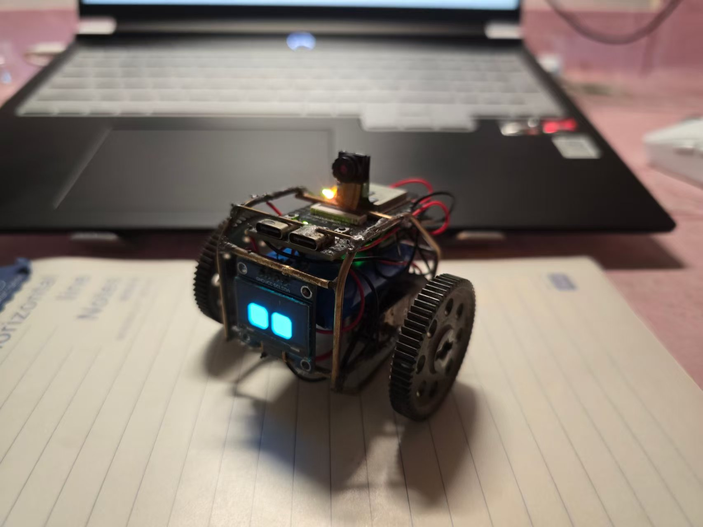
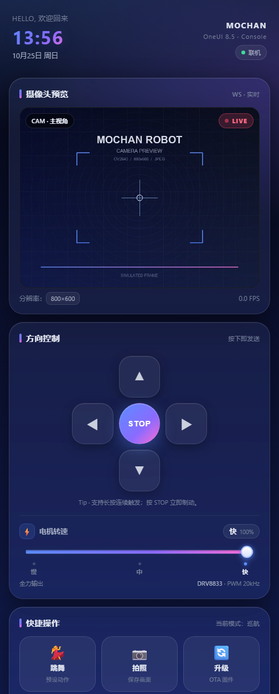
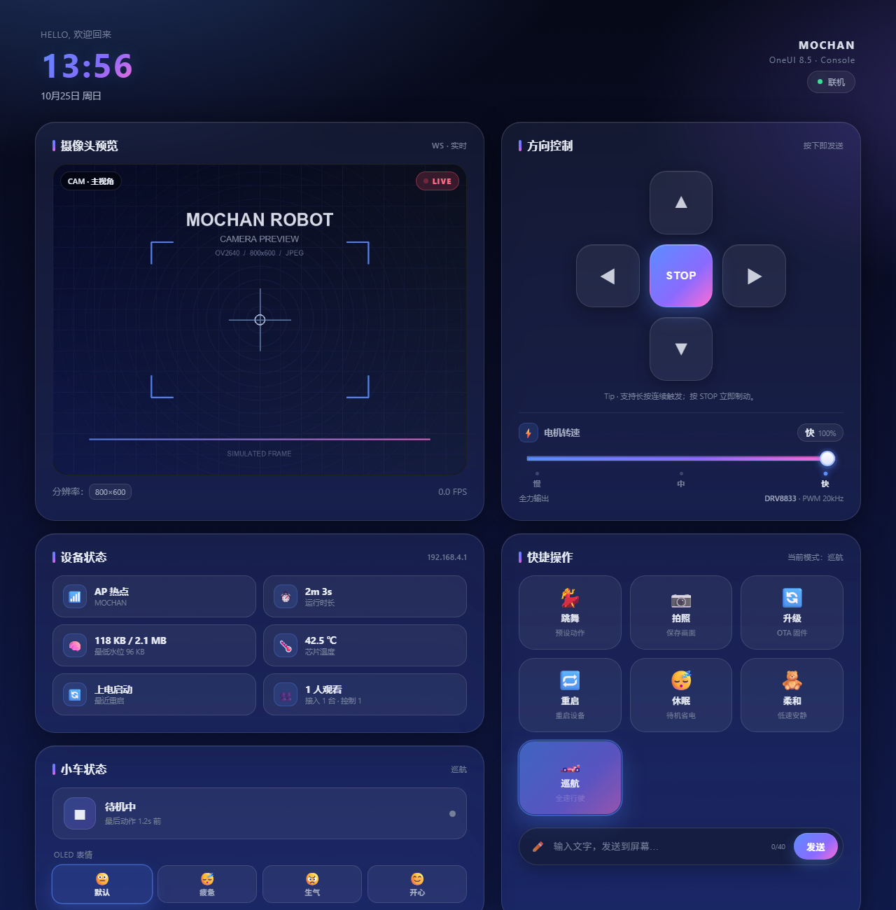
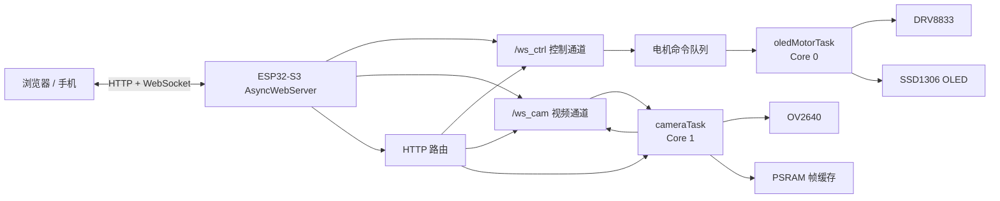
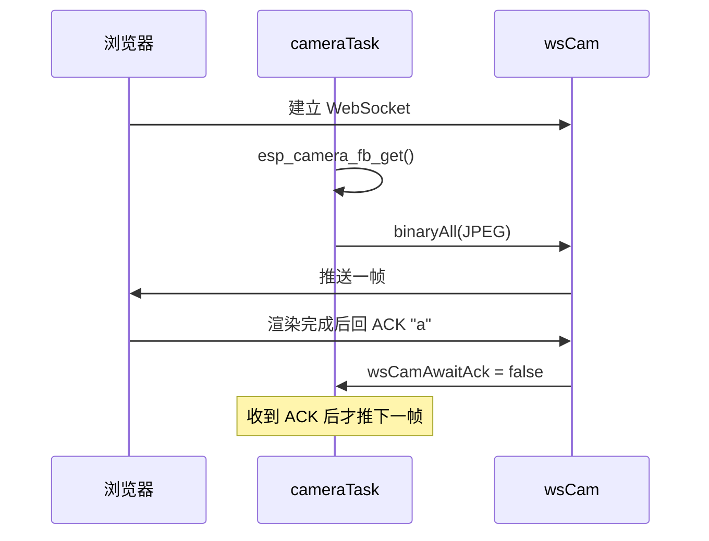

# MOCHAN Robot

<p align="center">
  
</p>

<p align="center">
  <b>ESP32-S3 · OV2640 · SSD1306 · DRV8833 · OneUI Web Console</b><br>
  一个用浏览器就能遥控的桌面机器人。
</p>

<p align="center">
  
  
  
  
</p>

**MOCHAN Robot** is a WiFi-controlled ESP32-S3 robot car with OV2640 camera streaming, SSD1306 OLED eyes, DRV8833 three-speed motor control, and a OneUI-inspired web console.

> 截图中的摄像头画面为占位图，实际画面由 OV2640 实时采集。

---

## 项目简介

MOCHAN Robot 是一个面向学习、DIY 和演示的桌面机器人项目。它把下面几件事集中在一块 ESP32-S3 上：

- 手机/电脑浏览器直接打开控制台，不需要安装 App；
- OV2640 摄像头实时图传，支持 WebSocket 低延迟视频和 MJPEG 兜底；
- SSD1306 OLED 显示机器人眼睛、表情、中文文字和休眠时钟；
- DRV8833 双 H 桥驱动两路直流电机，支持慢/中/快三档 PWM 调速；
- 支持 AP 热点和 STA 连接路由器两种模式；
- 支持网页 OTA 固件升级，带 MD5 完整性校验。

项目刻意保持“单 Sketch + 网页资源内嵌”的形态，方便用 Arduino IDE 直接编译、修改和烧录。当前主文件名为 `1.ino`；发布到 GitHub 时，请按 Arduino 的命名规则把文件和所在文件夹改成同一个名字（例如 `MOCHAN_Robot/MOCHAN_Robot.ino`），否则 Arduino IDE 会提示 sketch 必须放在同名文件夹中。

它不是量产产品，更适合作为嵌入式、网络、电机控制和前端交互的综合练习。

### 界面预览

<p align="center">
  
</p>
<p align="center">  </p>
> 桌面端见顶部大图；截图中的摄像头画面为占位图。

---

## 功能特性

### 控制台

- OneUI 风格的深色玻璃拟态界面，桌面/平板/手机三档响应式布局。
- 方向键支持点击和长按连发，松手自动发送停车命令。
- 三档转速滑块：慢 65%、中 82%、快 100%，档位掉电保存。
- 运行模式：休眠、柔和随机巡航、正常随机巡航。
- 快捷操作：跳舞、拍照、OTA、重启、OLED 表情切换。
- 屏幕文字发送：支持中英文，OLED 显示约 5 秒。
- 设备状态仪表盘：WiFi、IP、内存、PSRAM、温度、复位原因、在线人数、电机状态。
- 页面 gzip 传输：主页面约 44KB，压缩后约 14KB。

### 视频

- OV2640 DVP 摄像头，默认 800×600 JPEG。
- WebSocket 二进制帧推流，浏览器 ACK 背压，避免延迟越积越大。
- MJPEG `/stream` 兜底，WebSocket 不可用时自动降级。
- 单帧抓拍 `/capture`。
- PSRAM 帧缓存，默认单帧上限 192KB。

### 运动

- DRV8833 双 H 桥，IN1/IN2 直接 PWM 调速。
- LEDC 20kHz / 8bit，避开摄像头 XCLK 占用的 LEDC channel 0。
- 三档占空比：65% / 82% / 100%。
- 方向切换 2ms 死区 + 逐路 1ms 软启动，降低 H 桥直通和电机浪涌风险。
- 12ms 方向切换防抖；松手 200ms 无新命令自动停车。
- 速度档位保存在 NVS，行驶中切档只改占空比、不改方向。

### 显示与系统

- RoboEyes 眼睛动画，支持默认/疲惫/生气/开心四种表情。
- U8g2 文泉驿 GB2312 点阵字体，显示中文文字。
- 开机动画、休眠时钟、数字雨和扫描线效果。
- AP/STA 双模式，AP 模式带 DNS 强制门户。
- 网页 OTA，`X-Firmware-MD5` 校验，写入失败自动中止。
- 双核 FreeRTOS：Core 0 负责 OLED + 电机，Core 1 负责摄像头。

---

## 快速开始

1. 按下面的接线表连接摄像头、OLED、DRV8833 和电机；确认 `nSLEEP` 拉高、主控与驱动共地。
2. 把 `1.ino` 重命名为与所在文件夹同名的 `.ino`，用 Arduino IDE 打开。
3. 开发板选择 `ESP32S3 Dev Module`，开启 `OPI PSRAM`，分区选择 `Minimal SPIFFS (1.9MB APP with OTA)`。
4. 安装依赖库并编译烧录。
5. 连接热点 `MOCHAN`（密码 `12345678`），浏览器打开 `http://192.168.4.1`。

更完整的步骤见 [编译与烧录](#编译与烧录) 和 [使用说明](#使用说明)。

---

## 系统架构



### 双核分工

| 核心 | 任务 | 主要职责 |
|---|---|---|
| Core 0 | `oledMotorTask` | 执行电机命令、刷新 OLED、推进随机巡航/跳舞、处理手动超时 |
| Core 1 | `cameraTask` | 按帧率取图、写全局帧缓存、通过 WebSocket 推流 |
| Core 1 | `loop` | DNS 门户、WebSocket 清理、STA 断线看门狗 |

网络回调只负责“入队”和“改状态”，真正带 `delay()` 的电机时序放在 `oledMotorTask` 中执行，避免阻塞 `async_tcp` 任务导致视频卡顿。

---

## 硬件清单

| 模块 | 建议型号 | 数量 | 说明 |
|---|---|---|---|
| 主控 | ESP32-S3 DevKit N16R8 | 1 | 16MB Flash + 8MB PSRAM，摄像头和视频缓存需要 PSRAM |
| 摄像头 | OV2640 DVP 模块 | 1 | 3.3V 供电，24pin 软排线 |
| 显示屏 | SSD1306 128×64 I2C OLED | 1 | 地址通常为 `0x3C` |
| 电机驱动 | DRV8833 双 H 桥模块 | 1 | 支持 2 路直流电机，IN1/IN2 可直接 PWM |
| 电机 | TT 减速电机 + 轮子 | 2 | 左右各一 |
| 电源 | 2S 锂电池 / 5V 电源 | 1 | 电机电源与逻辑电源共地 |
| 车体 | 亚克力/3D 打印底盘 | 1 | 按电机尺寸选择 |

> 注意：ESP32-S3 的 3.3V 稳压器不适合直接给电机供电。电机请使用独立电池或 5V 电源，并与主控共地。

---

## 接线

### 摄像头 DVP

| 信号 | GPIO | 信号 | GPIO |
|---|---:|---|---:|
| XCLK | 15 | PCLK | 13 |
| SIOD (SDA) | 4 | SIOC (SCL) | 5 |
| VSYNC | 6 | HREF | 7 |
| D7 | 16 | D6 | 17 |
| D5 | 18 | D4 | 12 |
| D3 | 10 | D2 | 8 |
| D1 | 9 | D0 | 11 |
| PWDN | -1 | RESET | -1 |

### OLED

| 信号 | GPIO |
|---|---:|
| SDA | 40 |
| SCL | 41 |
| VCC | 3.3V |
| GND | GND |

### 电机与 DRV8833

| DRV8833 | ESP32-S3 | 说明 |
|---|---:|---|
| IN1 | 14 | 左轮正转 |
| IN2 | 21 | 左轮反转 |
| IN3 | 42 | 右轮正转 |
| IN4 | 1 | 右轮反转 |
| nSLEEP | 3.3V | 必须拉高，否则驱动不工作 |
| VM | 电池正极 | 电机电源 |
| GND | GND | 与主控共地 |
| OUT1/OUT2 | 左电机 | 左轮 |
| OUT3/OUT4 | 右电机 | 右轮 |

> 当前 `1.ino` 中 `INVERT_RIGHT_MOTOR = true`，表示右轮接线极性与默认方向相反。如果装好后发现某个轮子转反，不需要重新接线，改 `1.ino` 顶部的 `INVERT_LEFT_MOTOR` / `INVERT_RIGHT_MOTOR` / `SWAP_LEFT_RIGHT_MOTOR` 即可。

> `config.h`、`hw/`、`net/` 目录里还有一套早期模块化草案，引脚定义与当前 `1.ino` 不一致（例如旧草案使用 LF=47、RB=45）。当前实际编译入口是根目录 `1.ino`，接线请以本文和 `1.ino` 为准。

---

## 软件栈

| 依赖 | 用途 | 测试版本 |
|---|---|---|
| ESP32 Arduino Core | ESP32-S3 支持、LEDC、摄像头 | 4.0.0-alpha1 |
| Adafruit SSD1306 | OLED 基础绘图 | 2.5.17 |
| Adafruit GFX / BusIO | 图形与 I2C | 1.13.0 / 1.17.4 |
| U8g2 | 中文点阵字体 | 2.37.1 |
| FluxGarage RoboEyes | 眼睛表情动画 | 1.1.1 |
| AsyncTCP | 异步 TCP | 3.5.0 |
| ESPAsyncWebServer | Web 服务器 + WebSocket | 3.12.1 |
| esp_camera | OV2640 驱动 | ESP32 Core 内置 |
| Preferences | NVS 掉电保存 | ESP32 Core 内置 |
| DNSServer / Update | AP 门户 / OTA | ESP32 Core 内置 |

> LEDC 代码同时兼容 Core 2.x 和 Core 3.x/4.x：3.x 以上用 `ledcAttachChannel()` / `ledcWrite(pin, duty)`，2.x 用 `ledcSetup()` / `ledcAttachPin()` / `ledcWrite(channel, duty)`。

---

## 目录结构

```text
.
├── 1.ino                  # 当前实际编译入口：主程序
├── web_content.h          # 控制台 + OTA 页面（HTML/CSS/JS，PROGMEM）
├── web_content_gz.h       # 由 tools/embed_web.py 生成的 gzip 版本
├── tools/
│   └── embed_web.py       # 从 web_content.h 重新生成 gzip 数组
├── docs/
│   └── images/            # README 截图与摄像头占位图
├── config.h               # 早期模块化草案，未参与当前编译
├── hw/                    # 早期硬件模块草案，未参与当前编译
├── net/                   # 早期网络模块草案，未参与当前编译
└── utils/                 # 早期工具头文件，未参与当前编译
```

当前仓库保留了一些早期拆分文件，是为了方便后续重构；它们不会被 Arduino IDE 编译。开源发布时也可以选择删除，只保留 `1.ino`、`web_content*.h` 和 `tools/`。

---

## 工作原理

### 1. 启动流程

`setup()` 按 Phase 1~5 顺序执行：

1. **最早期安全锁定**：把 LF/LB/RF/RB 全部设为 `OUTPUT + LOW`，防止开机时 H 桥输入悬空导致轮子自转。
2. **PWM 初始化**：把四个电机脚挂到 LEDC 通道 4~7，20kHz、8bit，全部 0% 输出。
3. **恢复转速档位**：从 NVS 命名空间 `motor` 的 `spd3` 读取 0/1/2，默认「快 100%」。
4. **Phase 1**：打印芯片信息、创建 `cam_mutex` / `motor_mutex`、分配 PSRAM 帧缓存、初始化随机数。
5. **Phase 2**：读取 NVS 中的 WiFi 配置，优先 STA，失败回退 AP；启动 AsyncWebServer。
6. **Phase 3**：初始化 I2C、SSD1306、U8g2、RoboEyes，播放开机动画。
7. **Phase 4**：初始化 OV2640。
8. **Phase 5**：再次确认电机 0% 输出，创建 Core 0 / Core 1 两个 RTOS 任务。

### 2. 电机控制与三档 PWM

#### DRV8833 基本真值表

每个电机有两个输入脚，代码采用“一端 PWM、另一端 LOW”的调速方式：

| IN1 | IN2 | 结果 |
|---|---|---|
| PWM | 0 | 正转，占空比决定平均电压 |
| 0 | PWM | 反转，占空比决定平均电压 |
| 0 | 0 | 停止/滑行 |
| 1 | 1 | 刹车（当前代码未使用） |

#### 三档速度

| 档位 | 索引 | 占空比 | LEDC duty |
|---|---:|---:|---:|
| 慢 | 0 | 65% | 166 |
| 中 | 1 | 82% | 209 |
| 快 | 2 | 100% | 255 |

默认档位是「快 100%」，保存在 NVS 的 `motor/spd3`。修改档位时：

- 如果电机正在转，只更新当前方向对应的 PWM 占空比，不重新走 2ms 死区；
- 如果电机没转，只记录档位，下一次方向命令生效；
- 档位变化才写 NVS，避免频繁擦写。

#### 安全时序

`motorPwmApply()` 的执行顺序：

1. 记录目标桥臂位图，并把 `motorActiveMask` 清零；
2. 四路全部 0%，保持 2ms 死区；
3. 需要导通的桥臂逐个延迟 1ms 再上 PWM；
4. 更新 `motorActiveMask`，供后续“只改速度”使用。

此外还有两层保护：

- 方向切换 12ms 防抖，防止长按连发/网络重传叠加浪涌；
- 手动控制 200ms 超时，松手后没有新命令自动停车。

#### 方向命令映射

| 命令 | 动作 | 导通桥臂 |
|---:|---|---|
| 0 | STOP | 无 |
| 1 | 前进 | LF + RF |
| 2 | 后退 | LB + RB |
| 3 | 左转 | LB + RF |
| 4 | 右转 | LF + RB |
| 5 | 左轮后退 | LB |
| 6 | 右轮后退 | RB |
| 7 | 左轮前进 | LF |
| 8 | 右轮前进 | RF |

### 3. 视频链路与 ACK 背压



关键参数：

- `CAM_STREAM_FRAMESIZE = FRAMESIZE_SVGA`（800×600）
- `CAM_STREAM_JPEG_Q = 18`（数字越小画质越高、体积越大）
- `CAM_STREAM_FB_COUNT = 3`
- `CAM_STREAM_MAX_FPS = 30`
- `CAM_WS_ACK_TIMEOUT_MS = 200`
- 全局帧缓存上限 `CAM_BUF_MAX_SIZE = 192KB`
- 每个 MJPEG 客户端缓冲 192KB

设计思路是“在途永远最多 1 帧”：

- 浏览器渲染完一帧后回一个文本帧，服务端才推下一帧；
- 网络慢/手机解码慢时表现为**掉帧**，而不是延迟越积越大；
- 如果 200ms 没收到 ACK，服务端兜底推下一帧，避免完全卡死；
- WebSocket 不可用时，前端自动降级到 `/stream` 的 `multipart/x-mixed-replace`。

MJPEG 客户端由 `AsyncCamStreamResponse` 负责，自己持有一块 192KB 的帧副本，按 `boundary + Content-Length + JPEG` 分块发送。分配失败时 `handleStream()` 会直接返回 503，而不是把空指针交给 `memcpy`。

### 4. Web 控制台

`web_content.h` 里是完整的 HTML/CSS/JS，通过 C++ 字符串拼接放进 PROGMEM。`1.ino` 的 `handleRoot()` 根据浏览器的 `Accept-Encoding` 选择：

- 支持 gzip：发送 `PAGE_HTML_MAIN_GZ`，约 14KB；
- 不支持：回退到未压缩字符串，约 44KB。

`/ota` 页面同样支持 gzip，不再把 17KB 页面拷贝到 `String` 堆。

控制通道 `/ws_ctrl` 使用文本协议，前端优先 WebSocket，断线时自动用 HTTP `/f`、`/b` 等兜底。状态面板每 2 秒轮询 `/status`，`/ping` 每 5 秒检测一次在线状态。

#### 三档滑块

- HTML `<input type="range" min="0" max="2" step="1">`
- 轨道用蓝紫粉渐变填充，滑块是白色发光圆点；
- 三个刻度「慢 / 中 / 快」可以点击；
- 拖动时立即更新 UI，并通过 `sendCmd('spdN')` 发给 ESP32；
- 1.5 秒内不被 `/status` 的旧值覆盖。

### 5. WiFi 与网络

- **AP 模式**：默认 SSID `MOCHAN`，密码 `12345678`，IP `192.168.4.1`；DNS 强制门户会把任意域名解析到本机。
- **STA 模式**：网页里扫描 WiFi、保存 SSID/密码，设备重启后连接路由器；连接成功后关闭 WiFi 省电以降低视频延迟。
- **断线看门狗**：STA 断线超过 60 秒，自动清配置并重启回 AP，防止设备失联。
- **时间同步**：浏览器把 Unix 时间戳发给 `/sync_time`，OLED 休眠时钟使用同步后的时间。

> 默认 AP 密码只适合本地调试。开源部署前请修改 `1.ino` 中的 `AP_PASSWORD`。

### 6. OLED 显示

- `Adafruit_SSD1306`：眼睛动画、开机动画、休眠时钟、纯 ASCII 文字。
- `U8g2`：`u8g2_font_wqy12_t_gb2312` 中文点阵字体，按像素宽度自动折行，最多 4 行。
- 两种驱动共用 I2C（SDA 40 / SCL 41）。`u8g2.begin()` 内部会重新初始化 `Wire`，所以代码在 `begin()` 之后又把引脚指回 40/41。

显示逻辑分三态：

1. 有 Web 文字：显示文字 5 秒，期间只暂停画面刷新，不暂停电机状态机；
2. 休眠模式：显示数字雨 + 扫描线 + 北京时间 + 秒进度条；
3. 正常模式：RoboEyes 眼睛动画。

### 7. OTA 固件升级

1. 浏览器打开 `/ota`；
2. 选择 `.bin` 固件，可选填写 32 位 MD5；
3. 前端用 `XMLHttpRequest` 上传到 `/update`，并发送 `X-Firmware-MD5` 头；
4. 服务端 `Update.begin()` 后调用 `Update.setMD5()`；
5. 逐块 `Update.write()`，并检查返回值；写入不完整则 `Update.abort()`；
6. `Update.end(true)` 成功且 MD5 匹配后重启。

OTA 需要 OTA 分区。默认 4MB / 1.2MB APP 分区放不下当前固件，必须选择 **Minimal SPIFFS (1.9MB APP with OTA)** 或更大的 16M 分区方案。

---

## Web API

### HTTP 路由

| 方法 | 路径 | 参数 | 说明 |
|---|---|---|---|
| GET | `/` | - | 控制台首页（支持 gzip） |
| GET | `/ping` | - | 连通性探测，返回 `pong` |
| GET | `/f` `/b` `/l` `/r` `/s` | - | 前/后/左/右/停车 |
| GET | `/speed` | `level=0..2` | 设置三档转速 |
| GET | `/spd0` `/spd1` `/spd2` | - | 三档转速 HTTP 兜底 |
| GET | `/display_text` | `text=...` | OLED 显示文字 |
| GET | `/mode_off` | - | 休眠模式 |
| GET | `/mode_soft` | - | 柔和随机巡航 |
| GET | `/mode_normal` | - | 正常随机巡航 |
| GET | `/mood` | `m=0..3` | OLED 表情 |
| GET | `/status` | - | 设备状态 JSON |
| GET | `/stream` | - | MJPEG 视频流 |
| GET | `/capture` | - | 抓拍一张 JPEG |
| GET | `/sync_time` | `timestamp=...` | 同步 Unix 时间 |
| GET | `/dance` | - | 跳舞 |
| GET | `/wifi_scan` | - | 扫描附近 WiFi |
| GET | `/wifi_save` | `ssid=...&pwd=...` | 保存 WiFi 并重启 |
| GET | `/wifi_ap` | - | 清配置并回 AP |
| GET | `/restart` | - | 重启 |
| GET | `/ota` | - | OTA 页面 |
| POST | `/update` | multipart | OTA 固件上传 |

### WebSocket 控制命令

连接 `/ws_ctrl` 后发送文本帧：

| 命令 | 说明 |
|---|---|
| `f` / `b` / `l` / `r` / `s` | 前/后/左/右/停车 |
| `mode_off` | 休眠 |
| `mode_soft` | 柔和随机巡航 |
| `mode_normal` | 正常随机巡航 |
| `spd0` / `spd1` / `spd2` | 慢/中/快 |
| `speed=0..2` | 三档转速的另一种写法 |
| `mood0`..`mood3` | OLED 表情 |
| `dance` | 跳舞 |
| `text=...` | OLED 显示文字 |

`cmd,seq` 里的 `seq` 仍然兼容接收，但服务端不再用它做全局去重，避免多个客户端互相丢命令。

### `/status` 返回示例

```json
{
  "ssid": "MOCHAN",
  "rssi": 0,
  "ip": "192.168.4.1",
  "wifimode": "AP",
  "uptime": 123456,
  "heap": 121000,
  "psram": 2200000,
  "temp": 42.5,
  "rst": 1,
  "minheap": 98000,
  "wscam": 1,
  "wsctrl": 1,
  "apstas": 1,
  "mode": "normal",
  "sleep": false,
  "mood": 0,
  "speed": 2,
  "speedpct": 100,
  "speedduty": 255,
  "motor": {
    "cmd": 0,
    "name": "STOP",
    "active": false,
    "ago": 1234
  }
}
```

---

## 编译与烧录

> **Sketch 命名规则**：Arduino IDE 要求 `.ino` 文件与所在文件夹同名。当前仓库主文件是 `1.ino`（因为原始工程文件夹叫 `1`）。发布到 GitHub 时，建议把主文件重命名为 `MOCHAN_Robot.ino`，并确保它位于 `MOCHAN_Robot/` 目录下；否则 Arduino IDE 会报 “sketch must be in a folder named …”。

### Arduino IDE 设置

| 选项 | 值 |
|---|---|
| Board | ESP32S3 Dev Module |
| Flash Size | 16MB (128Mb) |
| PSRAM | OPI PSRAM（N16R8） |
| Partition Scheme | Minimal SPIFFS (1.9MB APP with OTA) |
| CPU Frequency | 240MHz |
| Upload Speed | 921600 |

### 需要安装的库

- Adafruit SSD1306 2.5.17
- Adafruit GFX Library 1.13.0
- Adafruit BusIO 1.17.4
- U8g2 2.37.1
- FluxGarage RoboEyes 1.1.1
- AsyncTCP 3.5.0
- ESP Async WebServer 3.12.1
**如果使用最新版的库出现问题可使用这些版本**
### Arduino CLI

```bash
arduino-cli compile \
  --fqbn "esp32:esp32:esp32s3:PartitionScheme=min_spiffs,FlashSize=16M,PSRAM=opi" \
  .
```

上传：

```bash
arduino-cli upload \
  -p COM5 \
  --fqbn "esp32:esp32:esp32s3:PartitionScheme=min_spiffs,FlashSize=16M,PSRAM=opi" \
  .
```

> 测试编译结果：约 1,422,361 B（72%），RAM 约 61,360 B（18%）。不同 ESP32 Core 版本会有少量差异。

> Windows PowerShell 中请把上面的命令写成一行；`\` 续行是 bash 写法。

### 常见问题

**编译提示 Sketch too big**

默认 1.2MB APP 分区放不下，切换到 `Minimal SPIFFS (1.9MB APP with OTA)`，或使用 16M 的 3MB APP 分区。

**摄像头初始化失败**

检查 OV2640 排线方向、3.3V 供电、PSRAM 是否开启；N16R8 一般选 `OPI PSRAM`。

**电机不转**

检查 DRV8833 的 `nSLEEP` 是否拉高、VM 是否有电机电源、主控与驱动是否共地；再检查 `INVERT_*` 极性宏。

**OLED 不亮**

检查 I2C 地址是否为 `0x3C`，SDA/SCL 是否接在 40/41，总线是否有上拉。

**修改网页后 gzip 版本过期**

运行：

```bash
python tools/embed_web.py
```

它会从 `web_content.h` 重新生成 `web_content_gz.h`。只依赖 Python 标准库。

---

## 使用说明

1. 给机器人上电，OLED 会显示开机动画和当前 IP。
2. 手机/电脑连接 WiFi：`MOCHAN`，密码 `12345678`。
3. 浏览器打开 `http://192.168.4.1`。
4. 用方向键控制移动，拖动滑块切换慢/中/快。
5. 在「网络设置」里扫描并连接家里的 WiFi，设备重启后通过 OLED 上的新 IP 访问。
6. 在「升级」页面选择 `.bin` 固件，可选填 MD5，上传后设备自动重启。

> 如果 STA 模式连接失败，设备会自动回退 AP；连续断线 60 秒也会清配置回 AP。

---

## 设计取舍

- **20kHz PWM**：高于人耳可听范围，避免电机啸叫；DRV8833 支持到 250kHz。
- **2ms 死区 + 1ms 逐路软启动**：牺牲约 6ms 响应，换取更安全的 H 桥切换和更小的启动浪涌。
- **192KB 帧缓存**：在 SVGA q18 下留足余量，同时避免每个 MJPEG 客户端占用 512KB。
- **ACK 背压**：宁可掉帧也不让视频延迟累积。
- **页面 gzip**：多占约 20KB Flash，换来每次加载少传输约 30KB。
- **单 Sketch**：牺牲部分模块化，换取 Arduino IDE 直接打开即可编译的便利。
- **NVS 只在档位变化时写入**：减少 Flash 擦写。

---

## 安全说明

当前版本是**本地调试/学习项目**，默认没有登录鉴权，也没有 HTTPS：

- `/update`、`/restart`、`/wifi_save`、`/wifi_ap`、`/stream`、`/capture` 等接口默认对同一网络内的设备开放；
- 默认 AP 密码是 `12345678`，请在使用前修改；
- OTA 的 MD5 只用于完整性校验，不是数字签名，不能防止恶意固件；
- NVS 中的 WiFi 密码默认是明文存储；
- `/stream` 带有 `Access-Control-Allow-Origin: *`，方便调试，但也会允许同网络网页加载视频。

建议：

1. 只在可信局域网使用，或给设备单独划分 IoT VLAN；
2. 修改默认 AP 密码；
3. 至少给 OTA、重启、WiFi 配置接口加 Token/Basic Auth；
4. 如果要在公网访问，前面加反向代理、HTTPS 和身份认证。

---

## 已知限制与路线图

- [ ] 增加 Web/OTA/WiFi 接口鉴权
- [ ] 增加 HTTPS 或反向代理部署说明
- [ ] 无观众时降低摄像头帧率，减少发热和功耗
- [ ] 限制同时观看 MJPEG 的客户端数量
- [ ] 增加电池电压/电流监测
- [ ] 增加 DRV8833 nSLEEP GPIO 控制
- [ ] 增加编码器闭环或里程计
- [ ] 把 `config.h` / `hw` / `net` 旧草案合并或删除
- [ ] 增加 GitHub Actions 编译检查
- [ ] 增加 OTA 回滚/版本号显示

---

## 贡献

欢迎提交 Issue 和 PR。提交前建议：

1. Arduino IDE 编译通过；
2. ESP32-S3-N16R8 CAM 开发板、OPI PSRAM

---

## 版权声明
本项目代码、硬件设计图纸版权归 Perhaps888 所有。
仅允许个人在线浏览学习，**未经本人书面许可，严禁商用、严禁修改、严禁二次分发、严禁用于任何实物制作。**
---

## 致谢

- [Espressif](https://www.espressif.com/)：ESP32-S3、ESP-IDF、esp_camera
- [Arduino](https://www.arduino.cc/)：Arduino Core for ESP32
- [Adafruit](https://www.adafruit.com/)：SSD1306 / GFX 库
- [U8g2](https://github.com/olikraus/u8g2)：中文点阵字体渲染
- [FluxGarage RoboEyes](https://github.com/FluxGarage/RoboEyes)：眼睛动画
- [ESPAsyncWebServer](https://github.com/me-no-dev/ESPAsyncWebServer)：异步 Web 服务器
- [AsyncTCP](https://github.com/me-no-dev/AsyncTCP)：异步 TCP

---

<p align="center">
  Made with ❤️ for ESP32, robots and web consoles.
</p>
